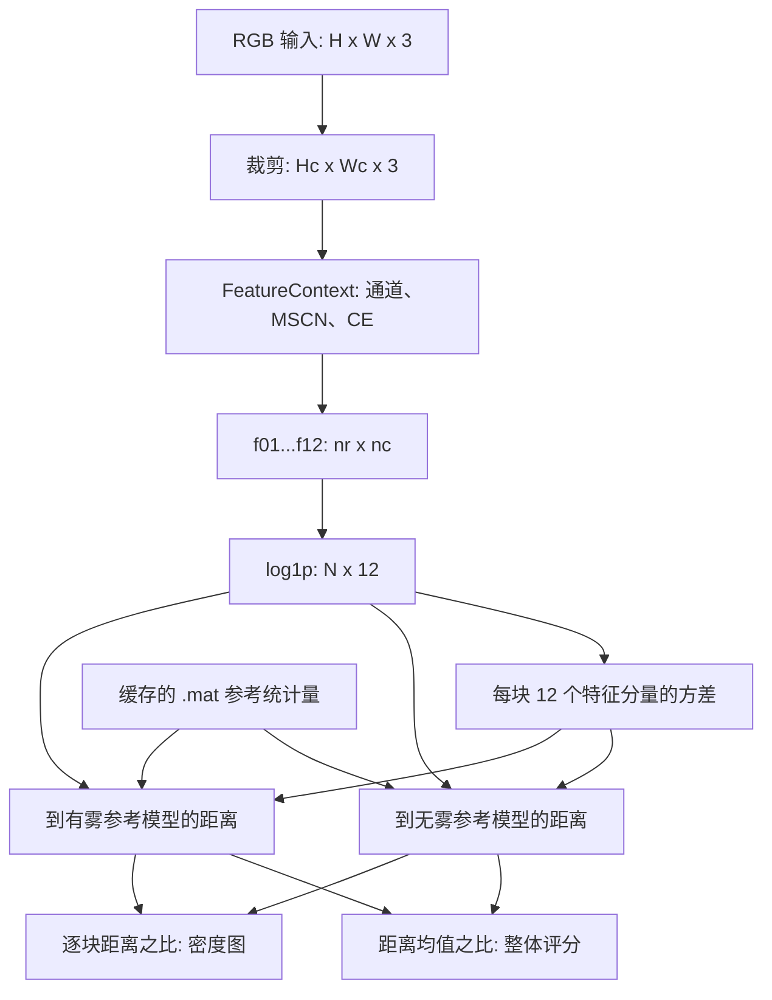
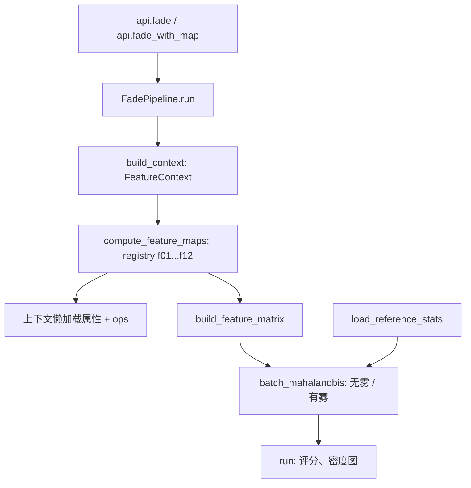

# FADE 技术文档：论文、算法与 Python 实现

[简体中文](technical_documentation.md) | [English](technical_documentation_EN.md) | [日本語](technical_documentation_JA.md)

本文面向论文复现研究者，以仓库中的论文 PDF 和当前源码为依据。**论文依据**说明作者的定义与实验；**程序事实**描述本项目实际执行的计算；**解释**用于连接数学、感知意义和代码，不构成独立实验结论。核对的代码基线为 `50643c5`。

## 目录

1. [论文介绍](#paper)
2. [符号与整体流程](#flow)
3. [预处理与 12 个特征](#features)
4. [参考统计与评分](#score)
5. [程序实现](#implementation)
6. [论文与实现对照](#comparison)
7. [样例、测试与限制](#validation)
8. [优化与参考资料](#references)

<a id="paper"></a>

## 1. 论文介绍

Lark Kwon Choi, Jaehee You, and Alan Conrad Bovik. **Referenceless Prediction of Perceptual Fog Density and Perceptual Image Defogging.** IEEE Transactions on Image Processing, 24(11), 3888–3901, 2015. DOI: `10.1109/TIP.2015.2456502`. [仓库内原论文](../reference/FADE.pdf)。

旧文档引用中的 “Perceptual Image Quality” 不是此 PDF 的实际题名；正确后半部分是 “Perceptual Image Defogging”。本次纠正技术文档的引用，README 按约定保持现状。下文页码使用期刊印刷页码：3888–3901 对应 PDF 第 1–14 页。

<a id="paper-background"></a>

### 1.1 研究问题与物理背景

**论文依据：** [原论文](../reference/FADE.pdf)，§I–II-A，式 (1)–(5)，pp. 3888–3890。

论文希望从单张图像预测感知雾浓度，无需同一场景的无雾图像、深度或透射图、显著目标定位、辅助地理信息或主观评分监督。用于解释雾图像的简化光学模型为：

$$
I(x)=J(x)t(x)+A(1-t(x)),\qquad t(x)=\exp(-\beta d(x)).
$$

其中 $J$ 为无雾场景辐射，$A$ 为全局环境光，$t$ 为透射率，$\beta$ 为衰减系数，$d$ 为场景距离。模型解释了对比度下降、颜色变淡和亮度偏移；FADE 从这些现象提取统计特征，并不在本程序中估计 $t$ 或恢复 $J$。解释：感知评分不是具有物理单位的雾浓度或能见距离。

<a id="paper-contributions"></a>

### 1.2 FADE、参考模型与 DEFADE

**论文依据：** [原论文](../reference/FADE.pdf)，§II-B、§III、§IV，pp. 3890–3896。

自然场景统计（NSS）描述自然图像中的统计规律。局部去均值与对比度归一化产生 MSCN 系数；论文观察到，雾会改变 MSCN 及垂直相邻乘积的分布，并使多种局部对比度、颜色和亮度特征发生变化。FADE 将 12 个特征与有雾、无雾的多元高斯（MVG）参考模型比较。无需主观评分训练不等于无需参考统计模型。

论文的另一项贡献 DEFADE 是去雾方法：对白平衡及两种对比度增强候选图像计算权重，利用局部 FADE 信息，执行拉普拉斯多尺度融合。该方法位于 §IV，式 (21)–(33)。本项目只提供 FADE 评分和图像块密度图，未实现 DEFADE 的候选生成、权重融合或图像重建。

<a id="paper-experiments"></a>

### 1.3 论文的实验与结论

**论文依据：** [原论文](../reference/FADE.pdf)，§III-C、§V-A、§VI-B，表 II，pp. 3893, 3896–3897。

- 参考建模语料：500 张无雾图像和 500 张有雾图像，参考模型构建时选择代表性图像块。
- 主观实验：另取与参考语料内容分离的 100 张测试图像，由 20 名参与者评定雾程度并形成 MOS。
- 论文报告：8×8 图像块取得最佳 LCC 0.8934（计算前做逻辑非线性回归）；16×16 图像块取得最佳 SROCC 0.8756。两个最佳值来自不同图像块尺寸。
- 论文还以去雾结果检验 FADE，并比较 DEFADE 的视觉效果与客观指标。这些属于论文实验，本项目未重新执行该主观研究。

<a id="flow"></a>

## 2. 符号与整体流程

本节起，未特别标记为“论文”的公式表示当前程序的计算。图像块尺寸固定为 $P=8$；块编号 $b$ 按行优先排列。

$$
n_r=\lfloor H/P\rfloor,\quad n_c=\lfloor W/P\rfloor,\quad H_c=Pn_r,\quad W_c=Pn_c,\quad N=n_rn_c,\quad K=P^2=64.
$$

| 符号 | 含义与尺寸 |
| --- | --- |
| $I$ | RGB 输入，$(H,W,3)$，约定为 `uint8`、0–255 |
| $I_c$ | 裁剪后的 RGB 图像，$(H_c,W_c,3)$，保留左上区域 |
| $p_b$ | 第 $b$ 个 8×8 图像块，包含 $K=64$ 个像素 |
| $Y,\mu,\sigma,M,V$ | 灰度、局部均值、局部标准差、MSCN、垂直乘积图，$(H_c,W_c)$ |
| $F_k$ | 第 $k$ 个特征图，$(n_r,n_c)$，$k=1,\ldots,12$ |
| $z_b$、$Z$ | 经 `log1p` 的特征向量、矩阵，$(12,)$、$(N,12)$ |
| $\nu_r,\Sigma_r$ | 类别 $r$ 的参考均值、协方差，$(12,)$、$(12,12)$ |
| $v_b$、$C_b^{(r)}$ | 当前程序的块内特征方差标量、混合矩阵，标量、$(12,12)$ |
| $d_b^{(r)},D$、$D_{\mathrm{map}}$ | 块距离、全图评分、密度图，$(N,)$、标量、$(n_r,n_c)$ |



公共 API 为 `fade(I) -> float` 和 `fade_with_map(I) -> (float, ndarray)`。两者都执行完整流水线；`fade()` 仅在返回时丢弃密度图。评分越高通常表示感知雾更浓。图像内容、噪声和其他失真也可能影响统计量，不能把评分单独解释为通用图像质量或去雾保真度。

<a id="features"></a>

## 3. 预处理与 12 个特征

<a id="preprocessing"></a>

### 3.1 共享预处理

**程序事实：** [`models/context.py`](../src/fade/models/context.py) 先裁剪图像，再按需缓存通道。R/G/B 转为 `float64`；灰度有两个不同定义：

$$
Y=\operatorname{round}(0.2989R+0.5870G+0.1140B),\qquad Y_{\mathrm{CE}}=0.299R+0.587G+0.114B.
$$

$Y$ 保存为 `int32`，用于 MSCN 和熵；$Y_{\mathrm{CE}}$ 不取整，用于灰度 CE。`np.round` 的半整数舍入规则为 ties-to-even。颜色对立通道为：

$$
rg=R-G,\qquad yb=0.5(R+G)-B.
$$

论文称第二个通道为 yellow-blue（`yb`）；代码使用变量名 `by`，但符号与上式一致。它们是浮点差值，可为负数，不能称为 0–255 的 `uint8` 通道。

**论文依据：** [原论文](../reference/FADE.pdf)，§II-B，式 (6)–(8)，p. 3891。

$$
w_{ij}=\frac{\exp[-(i^2+j^2)/(2s_w^2)]}{\sum_{u=-3}^{3}\sum_{v=-3}^{3}\exp[-(u^2+v^2)/(2s_w^2)]},\quad i,j\in\{-3,\ldots,3\},\quad s_w=7/6.
$$

$$
\mu=w*Y,\qquad \sigma=\sqrt{\left|w*(Y^2)-\mu^2\right|},\qquad M=\frac{Y-\mu}{\sigma+1},\qquad \xi=\frac{\sigma}{\mu}.
$$

程序由 [`ops/mscn.py`](../src/fade/ops/mscn.py) 使用 7×7 高斯核、`mode="nearest"` 卷积。绝对值处理浮点误差可能造成的负二阶矩差；MSCN 的分母加 1，而 $\xi$ 的分母没有保护项。论文说明 7×7 支撑与归一化高斯权重；这里的 $s_w=7/6$、边界模式和灰度舍入属于可核对的代码参数。

定义块平均 $\langle A\rangle_b=K^{-1}\sum_{x\in p_b}A(x)$。以下 $V_1(a)$ 表示样本方差：对 $n$ 个参与计算的值，减去均值后平方求和，再除以 $n-1$。`nanvar` 会忽略 `NaN`，`var`/`std` 不会；这些函数都不会自动删除 `inf`。

$$
V_1(a)=\frac{1}{n-1}\sum_{i=1}^{n}(a_i-\bar a)^2,\qquad \bar a=\frac{1}{n}\sum_{i=1}^{n}a_i.
$$

<a id="feature-index"></a>

### 3.2 特征顺序与论文对应

| 特征 | 内容 | 论文依据 | 代码 |
| --- | --- | --- | --- |
| [f01](#f01) | MSCN 方差 | Table I; Eq. (6) | [`features/f01.py`](../src/fade/features/f01.py) |
| [f02](#f02) | 非负垂直乘积方差 | Table I; Eq. (9) | [`features/f02.py`](../src/fade/features/f02.py) |
| [f03](#f03) | 非正垂直乘积方差 | Table I; Eq. (9) | [`features/f03.py`](../src/fade/features/f03.py) |
| [f04](#f04) | 局部标准差均值 | Eq. (8) | [`features/f04.py`](../src/fade/features/f04.py) |
| [f05](#f05) | 变异系数均值 | Eq. (10) | [`features/f05.py`](../src/fade/features/f05.py) |
| [f06](#f06) | 灰度 CE 均值 | Eqs. (11)–(12) | [`features/f06.py`](../src/fade/features/f06.py) |
| [f07](#f07) | 黄蓝 CE 均值 | Eqs. (11)–(12) | [`features/f07.py`](../src/fade/features/f07.py) |
| [f08](#f08) | 红绿 CE 均值 | Eqs. (11)–(12) | [`features/f08.py`](../src/fade/features/f08.py) |
| [f09](#f09) | 灰度熵 | Eq. (13) | [`features/f09.py`](../src/fade/features/f09.py) |
| [f10](#f10) | 像素暗通道均值 | Eq. (14) | [`features/f10.py`](../src/fade/features/f10.py) |
| [f11](#f11) | 饱和度均值 | Eq. (15) | [`features/f11.py`](../src/fade/features/f11.py) |
| [f12](#f12) | 色彩丰富度 | Eq. (16) | [`features/f12.py`](../src/fade/features/f12.py) |

表 I 与特征定义位于 pp. 3891–3892；§III-B 说明 f04–f08、f10、f11 在块内取平均，其余特征直接由块计算。以下解释的雾相关趋势是统计直觉，不保证对任意图像都严格单调。

<a id="f01"></a>

### 3.3 f01：MSCN 方差

$$
f_1(b)=V_1\bigl(\{M(x):x\in p_b\}\bigr).
$$

**定义与含义：** 衡量归一化局部结构的离散程度；雾引起的局部对比度变化会影响 MSCN 分布的宽度（§III-A、表 I，p. 3891–3892）。

**实现步骤：** 取得共享 $M$ → 切成 $(n_r,n_c,64)$ → 对最后一维执行 `np.nanvar(..., ddof=1)`。统计的是 MSCN 系数，不是原图灰度方差。

<a id="f02"></a>

### 3.4 f02：非负垂直乘积方差

$$
V(i,j)=M(i,j)M((i-1)\bmod H_c,j),\qquad S_b^+=\{V(x):x\in p_b,\ V(x)\geq0\},\qquad f_2(b)=V_1(S_b^+).
$$

**定义与含义：** 表示垂直邻域中同号 MSCN 乘积的分散程度，对应论文表 I 的正侧方差（式 (9)，p. 3891）。

**实现步骤：** `M * np.roll(M, 1, axis=0)` 生成共享乘积图 → 分块 → 复制块数组，将负值设为 `NaN` → `nanvar(ddof=1)`。0 被保留。论文式 (9) 写的是 $(i+1,j)$；代码使用上一行，并将首行与末行相乘。块归属和边界不同，不能直接宣称相同。

<a id="f03"></a>

### 3.5 f03：非正垂直乘积方差

$$
S_b^-=\{V(x):x\in p_b,\ V(x)\leq0\},\qquad f_3(b)=V_1(S_b^-).
$$

**定义与含义：** 表示异号乘积的分散程度，与 f02 一起描述垂直乘积分布两侧的形状（§III-A、表 I）。

**实现步骤：** 复用 f02 的乘积块 → 复制，将正值设为 `NaN` → `nanvar(ddof=1)`。0 同时参与 f02 与 f03；若保留下来的非 `NaN` 值不足 2 个，结果为 `NaN`，可触发自由度警告。

<a id="f04"></a>

### 3.6 f04：局部标准差均值

$$
f_4(b)=\langle\sigma\rangle_b.
$$

**定义与含义：** 用局部灰度波动描述锐度和结构信息（论文式 (8)，p. 3891）。

**实现步骤：** 从 MSCN 的共享计算中取得 $\sigma$ → 分块 → `np.mean(..., axis=2)`。这是每像素高斯加权标准差的块平均，不是直接对整块灰度求一次标准差。单位与未归一化的灰度强度一致。

<a id="f05"></a>

### 3.7 f05：变异系数均值

$$
f_5(b)=\langle\xi\rangle_b=\left\langle\frac{\sigma}{\mu}\right\rangle_b.
$$

**定义与含义：** 相对局部亮度衡量灰度离散程度（论文式 (10)，p. 3892）。

**实现步骤：** 逐像素计算 $\sigma/\mu$ → 分块 → 求平均。不是 $\langle\sigma\rangle_b/\langle\mu\rangle_b$；代码不加 epsilon，也不使用 `nanmean`，因此零均值区域可能传递 `NaN` 或 `inf`。

<a id="ce"></a>

### 3.8 f06–f08 共用的对比度能量算子

**论文依据：** [原论文](../reference/FADE.pdf)，§III-A，式 (11)–(12)，p. 3892。

**程序事实：** [`ops/ce.py`](../src/fade/ops/ce.py) 对 $c\in\{Y_{\mathrm{CE}},yb,rg\}$ 计算两个方向的高斯二阶导数响应，再做幅值组合、除法归一化和噪声阈值处理。这里是两个方向的响应能量，不应将它简写成一次二维拉普拉斯滤波。

$$
Z_c=\sqrt{(c*h_h)^2+(c*h_v)^2},\qquad \alpha_c=\max_{x}Z_c(x),\qquad R_c=\frac{\alpha_c Z_c}{Z_c+0.1\alpha_c}.
$$

$$
\mathrm{CE}_c(x)=\begin{cases}R_c(x)-\tau_c,&R_c(x)-\tau_c>10^{-7},\\0,&\text{otherwise}.\end{cases}
$$

$\alpha_c$ 在整张裁剪图像的当前通道上计算，不是每个 8×8 块独立计算。论文给出尺度约 3.25 像素、窗口大小 20、增益 0.1，三个阈值约为 0.2353、0.2287、0.0528。当前源码保留了更具体的数值：

| 通道 | 阈值 $\tau_c$ 的源码表达式 |
| --- | --- |
| gray | `9.225496406318721e-4 * 255` |
| yb (`by`) | `8.969246659629488e-4 * 255` |
| rg | `2.069284034165411e-4 * 255` |

核的离散构造也影响复现。令 $s=3.25$，`break_off_sigma=3.0`；`np.arange(-3s,3s,1)` 生成 $q=0,\ldots,19$ 的 20 个采样点。先生成归一化高斯，再去除导数核的直流分量，并做二阶矩归一化：

$$
\begin{aligned}
&u_q=-3s+q,\\
&g_q=\frac{\exp(-u_q^2/(2s^2))}{\sum_{j=0}^{19}\exp(-u_j^2/(2s^2))},\\
&a_q=\left(\frac{u_q^2}{s^4}-\frac{1}{s^2}\right)g_q,\\
&b_q=a_q-\frac{1}{20}\sum_{j=0}^{19}a_j,\\
&h_q=\frac{b_q}{\sum_{j=0}^{19}u_j^2 b_j/2}.
\end{aligned}
$$

实现用 1×20 核及其转置，`ndimage.convolve(..., mode="constant")` 保持 SciPy 默认 `origin=0`。`border=20` 的默认路径先按原顺序拼接顶部/底部各 10 行、左右各 10 列，再在卷积后去掉这圈数据。这是边缘条带拼接，不能解释为重复单个边缘像素，也不同于 MSCN 的 `nearest` 模式。若 $\alpha_c=0$，除法可产生 `NaN`，但阈值比较为假，输出对应位置保持 0；现有纯色 CE 测试接受该结果。

<a id="f06"></a>

### 3.9 f06：灰度 CE 均值

$$
f_6(b)=\langle\mathrm{CE}_{Y_{\mathrm{CE}}}\rangle_b.
$$

**计算步骤与含义：** 取得未取整的灰度通道 → 使用上述 CE 算子与灰度阈值 → 分块求平均。解释：捕捉亮度结构的局部对比度；所有 CE 参数均见上一节。 论文依据为式 (11)–(12) 与 §III-B，p. 3892。

<a id="f07"></a>

### 3.10 f07：黄蓝 CE 均值

$$
f_7(b)=\langle\mathrm{CE}_{yb}\rangle_b.
$$

**计算步骤与含义：** 取得 $yb=0.5(R+G)-B$（代码 `by`）→ 使用黄蓝阈值计算 CE → 分块求平均。解释：描述黄蓝色对立通道中的对比度变化，而不是该通道强度的平均。 论文依据为式 (11)–(12) 与 §III-B，p. 3892。

<a id="f08"></a>

### 3.11 f08：红绿 CE 均值

$$
f_8(b)=\langle\mathrm{CE}_{rg}\rangle_b.
$$

**计算步骤与含义：** 取得 $rg=R-G$ → 使用红绿阈值计算 CE → 分块求平均。解释：与 f07 一起描述色度结构的变化；雾往往减弱这些结构，但具体结果依赖图像内容。 论文依据为式 (11)–(12) 与 §III-B，p. 3892。

<a id="f09"></a>

### 3.12 f09：灰度熵

$$
p_b(h)=\frac{\#\{x\in p_b:Y(x)=h\}}{64},\qquad f_9(b)=-\sum_{h=0}^{255}p_b(h)\log_2 p_b(h),\qquad 0\log_2 0=0.
$$

**定义与含义：** 衡量块内灰度分布的信息量。论文式 (13)（p. 3892）写 `log`，当前代码明确采用底数 2，单位为 bit。8×8 块最多有 64 个样本，因此最大熵为 6 bit，即使灰度有 256 个可能取值。

**实现步骤：** 使用取整后的 $Y$ → 切成 64 像素块 → [`ops/entropy.py`](../src/fade/ops/entropy.py) 每批最多 4096 块，通过块索引 ×256 的偏移和 `bincount` 同时统计独立直方图 → 概率归一化并求和。不是对 RGB 三个通道分别取熵。

<a id="f10"></a>

### 3.13 f10：像素暗通道均值

$$
I_{\mathrm{dark}}(x)=\frac{\min(R(x),G(x),B(x))}{255},\qquad f_{10}(b)=\langle I_{\mathrm{dark}}\rangle_b.
$$

**定义与含义：** 衡量每个像素最暗颜色通道的亮度（论文式 (14)，p. 3892）。雾的环境光可提高暗通道值；天空或白色物体也可能有较高数值。

**实现步骤：** 对每像素三个通道取最小值 → 除以 255 → 分块平均，范围为 [0,1]。没有再执行空间邻域最小值滤波，因此不能与包含空间最小值的完整暗通道先验算子混同。

<a id="f11"></a>

### 3.14 f11：饱和度均值

$$
\begin{aligned}
&U=I_c/255,\\
&u_{\max}=\max_c U_c,\\
&u_{\min}=\min_c U_c,\\
&S=\begin{cases}(u_{\max}-u_{\min})/u_{\max},&u_{\max}>0,\\0,&u_{\max}=0,\end{cases}\\
&f_{11}(b)=\langle S\rangle_b.
\end{aligned}
$$

**定义与含义：** 对应 HSV 的 S 通道，刻画颜色相对于亮度的纯度（论文式 (15)，p. 3892）。灰色和黑色的饱和度为 0。

**实现步骤：** RGB 转为 `float32` 后除以 255 → 求通道最大值和最小值 → `np.divide(..., where=maximum>0)`，黑色位置保持 0 → 分块平均。代码只计算 S，没有计算 H/V；float32 的归一化和运算顺序属于实现约定。

<a id="f12"></a>

### 3.15 f12：色彩丰富度

$$
\begin{aligned}
&m_{a,b}=\langle a\rangle_b,\\
&s_{a,b}=\sqrt{V_1(\{a(x):x\in p_b\})},\\
&a\in\{rg,yb\},\\
&f_{12}(b)=\sqrt{s_{rg,b}^2+s_{yb,b}^2}+0.3\sqrt{m_{rg,b}^2+m_{yb,b}^2}.
\end{aligned}
$$

**定义与含义：** 第一项描述颜色的空间变化，第二项描述偏离灰色轴的均值偏移；权重为 0.3（论文式 (16)，p. 3892）。

**实现步骤：** 将共享 $rg,yb$ 分块 → 两通道各执行 `np.std(..., ddof=1)` 与 `np.mean` → 按公式组合。使用未归一化的颜色差值。论文式 (16) 后定义的方差分母为 $X$，代码标准差对应的方差分母为 $K-1$。这是可确认的样本/总体方差差异；文档不将其默认为等价。

<a id="score"></a>

## 4. 参考统计与评分

<a id="reference-models"></a>

### 4.1 论文参考模型与项目数据

**论文依据：** [原论文](../reference/FADE.pdf)，§III-B–D，式 (17)–(19)，pp. 3892–3893。

论文构建参考模型时，对参考语料的特征做 min–max 归一化，并用 f1、f4、f6、f9、f10、f11 选择代表性图像块；f10 在选择时反向处理。无雾语料倾向选择高信息块，有雾语料使用相反不等式。测试图像使用全部图像块。归一化和选择属于参考模型构建步骤，不能误加到当前推理路径上。

$$
p(z;\nu,\Sigma)=\frac{\exp[-\tfrac12(z-\nu)^\mathsf{T}\Sigma^{-1}(z-\nu)]}{(2\pi)^{12/2}|\Sigma|^{1/2}}.
$$

上式为论文式 (18) 的 12 维 MVG 密度。论文说明均值和协方差采用最大似然估计。项目只加载下列预计算参数，没有参考语料、图像块筛选或重新拟合训练入口：

| 文件 | 均值键 / 存储形状 | 协方差键 / 存储形状 |
| --- | --- | --- |
| [`natural_fogfree_image_features_ps8.mat`](../src/fade/data/natural_fogfree_image_features_ps8.mat) | `mu_fogfreeparam` / `(1,12)` | `cov_fogfreeparam` / `(12,12)` |
| [`natural_foggy_image_features_ps8.mat`](../src/fade/data/natural_foggy_image_features_ps8.mat) | `mu_foggyparam` / `(1,12)` | `cov_foggyparam` / `(12,12)` |

**程序事实：** 两组参数均为 `float64`。[`models/reference_stats.py`](../src/fade/models/reference_stats.py) 用 `importlib.resources` 定位包内数据，`scipy.io.loadmat` 读取，并用 `lru_cache(maxsize=1)` 缓存。文件命名和维度与 8×8、12 特征推理相符；仅凭这些文件，无法验证其生成语料、筛选过程或与作者官方参数逐字节一致。

<a id="feature-matrix"></a>

### 4.2 特征矩阵与程序的方差标量

$$
z_{b,k}=\ln(1+f_k(b)),\quad Z\in\mathbb{R}^{N\times12},\qquad v_b=\operatorname{nanvar}(z_{b,1},\ldots,z_{b,12};\mathrm{ddof}=1).
$$

特征图按 f01–f12 排序并沿行优先展平，再按列拼合。`np.log1p` 使用自然对数；论文 §III-D 说明使用对数非线性，但正文未将它明确写成 `log1p`。$v_b$ 是一个块的不同特征分量之间的方差，**不是**跨图像块估计的 12×12 特征协方差，也不是块内 64 个像素的方差。

<a id="distance"></a>

### 4.3 混合矩阵与距离

**论文依据：** [原论文](../reference/FADE.pdf)，§III-D，式 (19)，pp. 3893–3894。

论文的 Mahalanobis-like 距离使用参考模型与测试图像 MVG 拟合的均值和协方差：

$$
d_{\mathrm{paper}}=\sqrt{(\nu_1-\nu_2)^\mathsf{T}\left(\frac{\Sigma_1+\Sigma_2}{2}\right)^{-1}(\nu_1-\nu_2)}.
$$

**当前程序公式：** 令 $J_{12}=\mathbf{1}_{12}\mathbf{1}_{12}^{\mathsf T}$ 为全 1 矩阵；类别 $r$ 为 `free` 或 `foggy`。

$$
\begin{aligned}
&\Delta_b^{(r)}=\nu_r-z_b,\\
&C_b^{(r)}=\frac{v_bJ_{12}+\Sigma_r}{2},\\
&C_b^{(r)}x_b^{(r)}=\Delta_b^{(r)},\\
&d_b^{(r)}=\sqrt{\max\left((\Delta_b^{(r)})^\mathsf{T}x_b^{(r)},0\right)}.
\end{aligned}
$$

```python
batch_cov = (patch_var[start:stop, np.newaxis, np.newaxis] + ref_cov) / 2.0
x = np.linalg.solve(batch_cov, mu[:, :, np.newaxis])
dist_sq = np.einsum("ni,ni->n", mu, x[:, :, 0])
distances[start:stop] = np.sqrt(np.maximum(dist_sq, 0.0))
```

此片段来自 [`ops/distance.py`](../src/fade/ops/distance.py) 的循环体，`mu` 是当前批次的 $\Delta$，`ref_cov` 是 $\Sigma_r$。方差形状为 `(B,1,1)`，广播会加到参考矩阵的**所有元素**，不是只加对角线：旧文档的单位矩阵 $I_{12}$ 解释错误。程序使用每批最多 4096 块的直接线性求解，未显式构造逆矩阵；负的二次型被截为 0，`NaN` 保留，也没有奇异矩阵的正则化或求解失败回退。

<a id="aggregation"></a>

### 4.4 整体评分与局部密度图

**论文依据：** [原论文](../reference/FADE.pdf)，式 (20)，§VI-A，pp. 3894, 3897。

$$
\begin{aligned}
&D_f=\operatorname{nanmean}_b d_b^{(\mathrm{free})},\\
&D_{ff}=\operatorname{nanmean}_b d_b^{(\mathrm{foggy})},\\
&D=\frac{D_f}{D_{ff}+1},\\
&D_{\mathrm{map}}(b)=\frac{d_b^{(\mathrm{free})}}{d_b^{(\mathrm{foggy})}+1}.
\end{aligned}
$$

论文的 $D_f$ 名为 foggy level，实际是到**无雾**参考模型的距离；$D_{ff}$ 名为 fog-free level，实际是到**有雾**参考模型的距离。代码保持这一对应。常数 1 稳定分母。整体评分是两个距离均值的比，通常不等于密度图的均值；两组 `nanmean` 各自忽略自己的 `NaN`，没有先构建共同有效块掩码。若全部无效，整体评分可为 `NaN`。输出密度图保持块顺序，没有插值到像素分辨率、引导滤波或归一化到 [0,1]。

<a id="implementation"></a>

## 5. 程序实现

<a id="module-map"></a>

### 5.1 模块职责与调用关系

| 层 | 代码入口 | 职责 |
| --- | --- | --- |
| API | [`api.py`](../src/fade/api.py) | 单例默认流水线；返回标量或标量与图 |
| Pipeline | [`pipeline.py`](../src/fade/pipeline.py) | 创建上下文、特征矩阵、距离与输出 |
| Feature | [`features/base.py`](../src/fade/features/base.py) / [`features/registry.py`](../src/fade/features/registry.py) | 静态类型 Protocol 与固定 f01–f12 顺序 |
| Context | [`models/context.py`](../src/fade/models/context.py) | 当前图像的按需缓存与分块工具 |
| Ops | [`ops/mscn.py`](../src/fade/ops/mscn.py) / [`ops/ce.py`](../src/fade/ops/ce.py) / [`ops/entropy.py`](../src/fade/ops/entropy.py) / [`ops/distance.py`](../src/fade/ops/distance.py) / [`ops/patches.py`](../src/fade/ops/patches.py) | 可复用的数值算子 |
| Reference | [`models/reference_stats.py`](../src/fade/models/reference_stats.py) | 预计算参数的包内读取与进程内缓存 |



`Feature` 是 `typing.Protocol`，约定 `name` 和 `compute(context)`，不是带运行时抽象检查的 `abc.ABC`。每个特征模块导出一个无状态 `feature` 对象。`FadePipeline.default()` 从注册表生成完整序列；`run()` 检查特征矩阵非空且列数为 12，但不会逐个验证名字和语义顺序。自行替换注册顺序或特征会改变与参考模型的对应关系。公开 API 没有图像块尺寸参数；内部 `FeatureContext.patch_size` 可设置，不代表现有参考参数支持其他尺寸。

<a id="cache"></a>

### 5.2 共享缓存与数据类型

每次 `run()` 建立一个新的 `FeatureContext`，同一次推理的 12 个特征共享它。首次访问 `mscn` 时同时生成 $M,\sigma,\xi$；首次访问 `CE_gray` 时同时生成三通道 CE。f02/f03 共享 `mscn_v_patches`，CE 与 f12 共享 `rg/by`。这些缓存属于单次图像处理，不是跨图像的结果缓存；参考 `.mat` 则使用全局 LRU 缓存。

| 数组 | 数据类型 | 形状 |
| --- | --- | --- |
| 裁剪后的 RGB | 输入类型，通常为 `uint8` | `(Hc,Wc,3)` |
| R/G/B, MSCN, sigma, CV, rg/by, CE | `float64` | `(Hc,Wc)` |
| 取整灰度 / 熵索引 | `int32` | `(Hc,Wc)` / 取决于批次 |
| 饱和度 | `float32` | `(Hc,Wc)` |
| 特征图 | 通常为 `float64`；f11 为 `float32` | `(nr,nc)` |
| 特征矩阵 | `float64` | `(N,12)` |
| 参考参数 / 输出密度图 | `float64` | `(12,)`, `(12,12)` / `(nr,nc)` |

<a id="array-flow"></a>

### 5.3 分块、矩阵构造与源码片段

[`ops/patches.py`](../src/fade/ops/patches.py) 使用 `reshape(nr,8,nc,8)` → `transpose(0,2,1,3)` → `reshape(nr,nc,64)`；内部最后两个空间维度被展平，特征图 `ravel()` 对应相同的行优先块序。转置后再展平可能产生副本，因此不能称为始终零拷贝。

以下是 `build_feature_matrix()` 的非空输入分支；它先创建新的矩阵，再原地变换，不修改原特征图：

```python
flattened = [feature_map.ravel() for feature_map in feature_maps]
feat = np.column_stack(flattened).astype(np.float64, copy=False)
return np.log1p(feat, out=feat)
```

自然对数矩阵随后按每块求方差，用两类参考参数分别计算距离，最终构造整体评分和密度图。参数转换用 `astype(..., copy=False)`；引用已有 `float64` 参数时避免额外副本，不改变参考数值。

<a id="comparison"></a>

## 6. 论文与实现对照

本表区分明确差异、正文未规定的实现约定和未经核对的内容。差异记录并不自动判定代码应怎样修改；本次不改变算法。

| 项目 | 论文依据 | 当前实现与核对结论 |
| --- | --- | --- |
| 12 特征与参考类别 | 表 I、式 (19)–(20) | 特征类别、标准顺序及两类距离比相对应；仍需分别审查数值约定。 |
| 图像块 | §III-B、§VI-A：尺寸与重叠可变 | API 固定 8×8、非重叠，裁剪底部与右侧；随附 ps8 参数。 |
| MSCN 与灰度 | 式 (6)–(8)、式 (11) 后的灰度公式 | 代码明确 7/6 高斯尺度、nearest 边界、两种灰度和取整；这些细节不能全由论文正文推出。 |
| 相邻乘积 | 式 (9)：使用下一行 | 代码使用上一行及环绕边界；正、负侧都包含 0。 |
| CE 与边界 | 式 (11)–(12)：3.25、20、0.1 与约数阈值 | 代码给出精确核采样、直流去除、边缘条带拼接和 >1e-7 掩码；无官方实现核对。 |
| 熵 | 式 (13)：log，未明确底数 | 代码使用 log2、取整灰度与 256 个直方图格。 |
| 色彩丰富度 | 式 (16) 定义总体方差，分母 X | 代码 std(ddof=1)，分母 K-1；明确数值差异。 |
| 对数变换 | §III-D：对数非线性 | 代码使用自然对数 log1p；论文未明确 +1 约定。 |
| 测试图像协方差 | 式 (18)–(19)：MVG 均值与完整协方差拟合 | 代码每块使用 z_b 和跨 12 分量的方差，广播为 v_b J12；不是全图 MVG 拟合，论文未推导此替代。 |
| 整体评分 | 式 (20)：Df/(Dff+1) | 代码先独立 nanmean 两组块距离再求比；不是局部评分的均值。 |
| 参考参数与实验 | 500+500 参考语料、100 图像主观实验 | 只提供 .mat、三个样例与软件测试；参数来源过程和 MOS 相关性均未独立复现。 |
| 去雾与图像质量 | §IV 与 §VI-C：DEFADE 与多指标评价 | 本项目没有 DEFADE 或通用图像质量预测入口。 |

<a id="validation"></a>

## 7. 样例、测试与限制

<a id="samples"></a>

### 7.1 三张随附图像

以下为当前程序的实测结果，输入均通过 Pillow 转为 RGB。环境为 Python 3.13.3、NumPy 2.4.3、SciPy 1.17.1。评分保留 10 位小数；文件为本项目样例，不是原论文 100 图像实验的完整复现。

| 图像 | 输入 `(H,W,3)` | 裁剪后 `(Hc,Wc,3)` | FADE 评分 | 密度图 `(nr,nc)` |
| --- | --- | --- | --- | --- |
| [test_image1.png](../test_image/test_image1.png) | `(768,576,3)` | `(768,576,3)` | `0.9113393845` | `(96,72)` |
| [test_image2.JPG](../test_image/test_image2.JPG) | `(800,600,3)` | `(800,600,3)` | `2.7121977531` | `(100,75)` |
| [test_image3.jpg](../test_image/test_image3.jpg) | `(531,800,3)` | `(528,800,3)` | `5.7674386227` | `(66,100)` |

在项目根目录、包含 `demo` 依赖的环境中运行下列完整示例。它只读取样例图像，不修改文件；清晰和中等雾样例可能出现下文记录的自由度警告。

<a id="sample-code"></a>

```python
from pathlib import Path
import numpy as np
from PIL import Image
from fade import fade_with_map

for name in ("test_image1.png", "test_image2.JPG", "test_image3.jpg"):
    with Image.open(Path("test_image") / name) as image:
        rgb = np.array(image.convert("RGB"))
    score, density_map = fade_with_map(rgb)
    print(f"{name}: shape={rgb.shape}, score={score:.10f}, map={density_map.shape}")
```

```text
test_image1.png: shape=(768, 576, 3), score=0.9113393845, map=(96, 72)
test_image2.JPG: shape=(800, 600, 3), score=2.7121977531, map=(100, 75)
test_image3.jpg: shape=(531, 800, 3), score=5.7674386227, map=(66, 100)
```

<a id="tests"></a>

### 7.2 现有测试的范围与验证结果

在项目根目录运行：

```bash
uv sync --extra demo --extra test
uv run --extra test pytest
uv run --extra test pytest -m "not slow"
```

pip 环境可使用 `pip install -e ".[demo,test]"`，再执行 `python -m pytest`。本次已在现有虚拟环境执行完整 `python -m pytest -q`：**261 项通过，13 条 RuntimeWarning**，pytest 9.0.2。未新增测试或重新执行论文主观实验。

| 范围 | 现有测试依据与含义 |
| --- | --- |
| API / Pipeline | [test_api_integration.py](../tests/test_api_integration.py) / [test_pipeline.py](../tests/test_pipeline.py) — 返回类型、尺寸、重复性、非 8 倍数裁剪、16×16 小图、32×32 纯灰图。真实图像评分测试允许 10% 相对误差，参考值来自 Notebook，而非独立 MATLAB 基准。 |
| Features / Cache | [test_features_f01_f12.py](../tests/test_features_f01_f12.py) / [test_features_registry.py](../tests/test_features_registry.py) / [test_models_context.py](../tests/test_models_context.py) — 12 特征形状、数值性质、顺序、通道公式、缓存与典型颜色饱和度。 |
| Ops | [test_ops_entropy.py](../tests/test_ops_entropy.py) / [test_ops_distance.py](../tests/test_ops_distance.py) / [test_ops_ce.py](../tests/test_ops_ce.py) / [test_ops_mscn.py](../tests/test_ops_mscn.py) / [test_ops_patches.py](../tests/test_ops_patches.py) — 已知熵值、分批边界、与独立熵及直接求解的比较、float32 距离类型、滤波/拼接和分块行为。 |
| Reference | [test_models_reference.py](../tests/test_models_reference.py) — 参数键、维度、有限性、对称性、半正定性与缓存；不验证生成数据来源。 |

软件测试通过说明当前行为满足这些断言。它不能证明参考参数的原始生成过程、与官方实现完全一致，或在论文主观数据上达到相同 LCC/SROCC。

<a id="limits"></a>

### 7.3 当前边界行为与适用限制

- **输入约定与实际校验：** 文档约定 RGB、`uint8`、`(H,W,3)`。API 没有统一的类型、形状与最小尺寸检查；部分错误来自底层 NumPy/SciPy。饱和度属性另有数值范围检查，但这不是完整输入验证。不要把浮点输入、任意通道数或任意小图视为已承诺支持。
- **小图：** 现有端到端测试覆盖 16×16。小于一个块的尺寸裁剪后会产生空维度；CE 的边缘条带实现也依赖图像大小。测试不能支持“只要有一个 8×8 块就一定正常”的结论。
- **无效值：** f02/f03 的有效样本不足、CV 的零均值除法或其他退化数据可产生 `NaN/inf`。`np.errstate` 不会消除 `nanvar` 的自由度警告。f03 和 CE 除法构成本次报告的 13 条警告；NaN 在管线中并未全部替换为 0。
- **聚合与求解：** `nanmean` 只忽略 NaN，不自动忽略 inf。全部无效时的均值警告在最终聚合处被抑制，但仍可返回 NaN。距离求解没有奇异矩阵回退。
- **输出解释：** 密度图是块网格，评分没有固定等级阈值，也不限定为 [0,1]。用单一 FADE 数值判断去雾质量时，仍需考察保真度、伪影与其他评价指标。
- **复现边界：** 本仓库没有论文参考语料、MOS 标签、完整训练/筛选流程或官方代码核对记录；本次验证只覆盖随附样例和现有测试。

<a id="references"></a>

## 8. 优化与参考资料

<a id="optimizations"></a>

### 8.1 当前优化机制

- **共享中间量：** R/G/B、MSCN 与相关图、rg/by、CE 在上下文中按需缓存，避免跨特征重复生成。
- **只计算所需饱和度：** 保留 float32 路径，省去完整 HSV 的 H/V 计算及相关数组。
- **分批熵直方图：** 每批最多 4096 块；概率除法与熵乘法原地执行，直方图工作数组不随整图块数无限增长。
- **分批距离求解：** 每批最多 4096 个 12×12 矩阵，降低同时存活的协方差数组数量。并没有使用线程池或多进程；分批向量化不等于显式并行调度。
- **减少副本：** 新建特征矩阵上的 `log1p(out=...)`、参数 `copy=False` 和参考数据缓存减少分配及 I/O。
- **内存范围：** 分批只限制相关工作数组；图像通道、特征图、展平块数组等仍随图像尺寸增长。因此总内存不是固定常数。

本次没有新增性能实验。旧文档的 100×、50× 等倍率以及缺少完整测量记录的比较不作为验证结论保留。以上描述解释代码机制，不承诺特定硬件上的速度或内存数值。

<a id="source-index"></a>

### 8.2 引用与证据索引

| 论文位置 | 内容 | PDF 页码 |
| --- | --- | --- |
| §I–II-A; Eqs. (1)–(5), pp. 3888–3890 | 研究问题与光学模型 | 1–3 |
| §II-B; Eqs. (6)–(8), p. 3891 | MSCN | 4 |
| §III-A–B; Table I; Eqs. (9)–(16), pp. 3891–3892 | 特征与图像块聚合 | 4–5 |
| §III-B–D; Eqs. (17)–(19), pp. 3892–3893 | 参考块选择、MVG、距离 | 5–6 |
| Eq. (20); §IV; Eqs. (21)–(33), pp. 3894–3896 | FADE 比值与 DEFADE | 7–9 |
| §V-A; §VI-A–B; Table II, pp. 3896–3897 | 主观实验与 FADE 结果 | 9–10 |
| §VI-C; Tables IV–V, pp. 3898–3899 | DEFADE 评价 | 11–12 |

以上论文内容均来自[本地 PDF](../reference/FADE.pdf)，未查找外部官方实现。源码链接指向本仓库当前文件；[Notebook](../test_fade.ipynb) 展示样例与密度图。若以后修改算法或参考参数，应同时核对三种语言的公式、对照表和样例记录。
