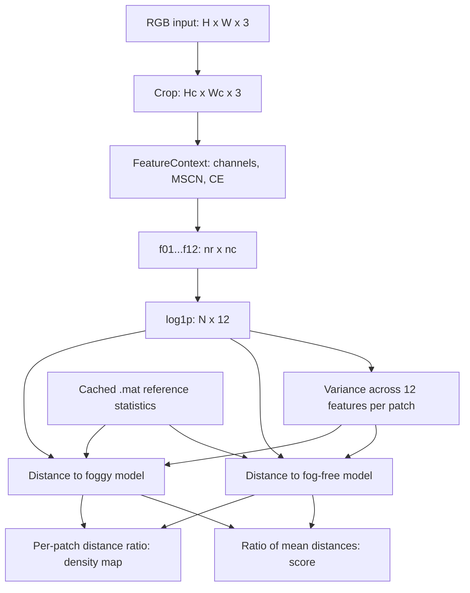
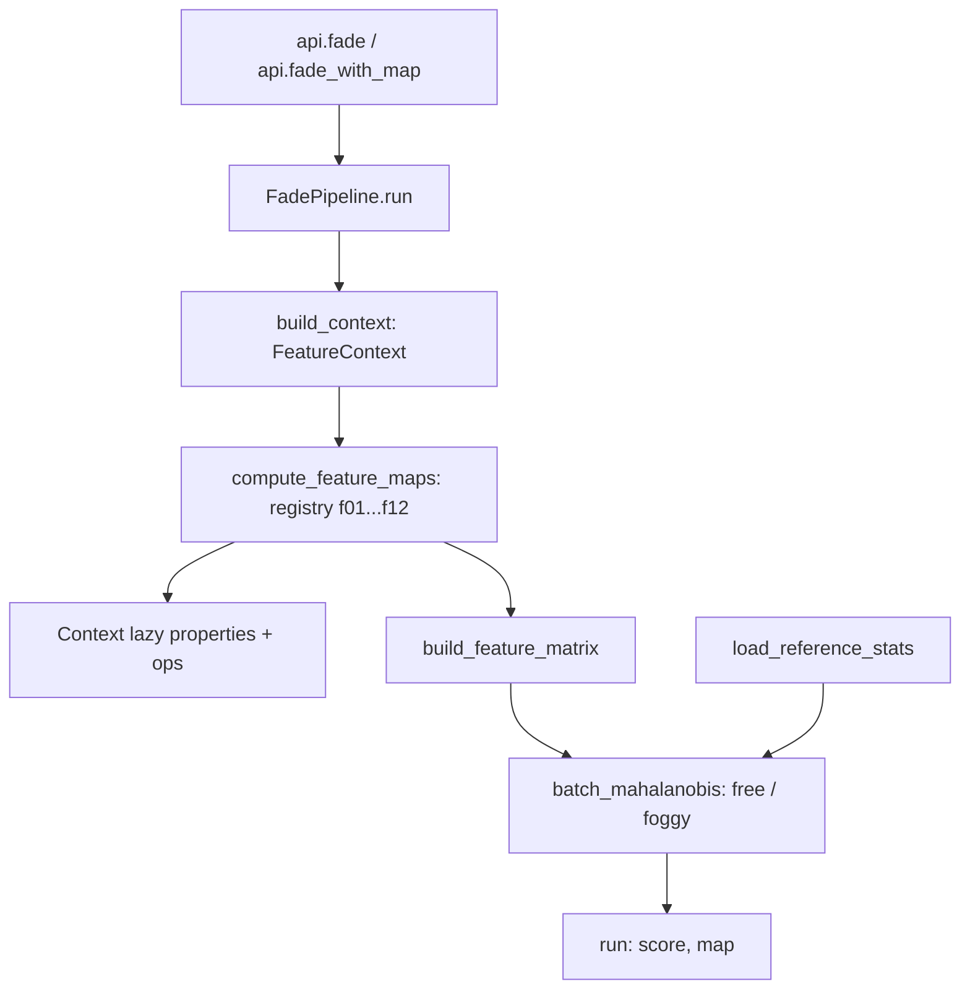

# FADE Technical Documentation: Paper, Algorithm, and Python Implementation

[简体中文](technical_documentation.md) | [English](technical_documentation_EN.md) | [日本語](technical_documentation_JA.md)

This document is for researchers reproducing FADE. Its sources are the paper PDF in this repository and the current code. **Paper sources** establish the authors’ definitions and experiments; **implementation facts** describe this project’s computations; **interpretations** connect mathematics, perceptual meaning, and code without constituting independent experimental results. The reviewed code baseline is `50643c5`.

## Contents

1. [Paper Overview](#paper)
2. [Notation and Overall Flow](#flow)
3. [Preprocessing and the 12 Features](#features)
4. [Reference Statistics and Scoring](#score)
5. [Program Implementation](#implementation)
6. [Paper–Implementation Comparison](#comparison)
7. [Examples, Tests, and Limitations](#validation)
8. [Optimizations and References](#references)

<a id="paper"></a>

## 1. Paper Overview

Lark Kwon Choi, Jaehee You, and Alan Conrad Bovik. **Referenceless Prediction of Perceptual Fog Density and Perceptual Image Defogging.** IEEE Transactions on Image Processing, 24(11), 3888–3901, 2015. DOI: `10.1109/TIP.2015.2456502`. [Paper PDF in this repository](../reference/FADE.pdf).

“Perceptual Image Quality” in the earlier citation is not the title of this PDF; the correct final phrase is “Perceptual Image Defogging.” This revision corrects the technical-document citation while leaving the READMEs as requested. Page references below use journal pages: 3888–3901 correspond to PDF pages 1–14.

<a id="paper-background"></a>

### 1.1 Research Problem and Physical Background

**Paper source:** [original paper](../reference/FADE.pdf), §I–II-A, Eqs. (1)–(5), pp. 3888–3890.

The paper seeks to predict perceptual fog density from one image without a fog-free counterpart, depth or transmission maps, salient-object localization, auxiliary geographical information, or supervision by human ratings. Its simplified optical model is:

$$
I(x)=J(x)t(x)+A(1-t(x)),\qquad t(x)=\exp(-\beta d(x)).
$$

Here $J$ is fog-free scene radiance, $A$ is global atmospheric light, $t$ is transmission, $\beta$ is attenuation, and $d$ is scene distance. The model explains reduced contrast, faint colors, and luminance shifts. FADE extracts statistical features associated with these effects; this program estimates neither $t$ nor a restored $J$. Interpretation: its perceptual score has no physical units of fog concentration or visibility distance.

<a id="paper-contributions"></a>

### 1.2 FADE, Reference Models, and DEFADE

**Paper source:** [original paper](../reference/FADE.pdf), §II-B, §III, §IV, pp. 3890–3896.

Natural scene statistics (NSS) describe regularities in natural images. Local mean subtraction and contrast normalization produce MSCN coefficients. The paper observes that fog changes the distributions of MSCN coefficients and vertical neighboring products, along with local contrast, color, and luminance features. FADE compares 12 features against foggy and fog-free multivariate Gaussian (MVG) reference models. Avoiding training on subjective ratings does not eliminate the need for reference statistics.

DEFADE, the paper’s other contribution, is a defogging method. It weights white-balanced and two contrast-enhanced candidate images, uses local FADE information, and performs Laplacian multiscale fusion (§IV, Eqs. (21)–(33)). This project provides FADE scores and patch-density maps; it does not implement DEFADE candidate generation, weight fusion, or image reconstruction.

<a id="paper-experiments"></a>

### 1.3 Experiments and Findings Reported in the Paper

**Paper source:** [original paper](../reference/FADE.pdf), §III-C, §V-A, §VI-B, Table II, pp. 3893, 3896–3897.

- Reference corpora: 500 fog-free and 500 foggy images, with representative patch selection when building the models.
- Subjective experiment: a separate, content-disjoint set of 100 test images rated by 20 participants to obtain MOS.
- Reported results: the best LCC was 0.8934 at 8×8 patches, after logistic nonlinear regression; the best SROCC was 0.8756 at 16×16 patches. These maxima belong to different patch sizes.
- The paper also evaluates FADE on defogged outputs and compares DEFADE visually and quantitatively. These are the authors’ experiments; this project has not repeated their subjective study.

<a id="flow"></a>

## 2. Notation and Overall Flow

From this section onward, formulas describe the current program unless explicitly labeled as paper definitions. Patch size is fixed at $P=8$; patch index $b$ follows row-major order.

$$
n_r=\lfloor H/P\rfloor,\quad n_c=\lfloor W/P\rfloor,\quad H_c=Pn_r,\quad W_c=Pn_c,\quad N=n_rn_c,\quad K=P^2=64.
$$

| Symbol | Meaning and shape |
| --- | --- |
| $I$ | RGB input, $(H,W,3)$; documented contract: `uint8`, 0–255 |
| $I_c$ | Cropped RGB image, $(H_c,W_c,3)$; top-left region retained |
| $p_b$ | Patch $b$, 8×8 with $K=64$ pixels |
| $Y,\mu,\sigma,M,V$ | Gray, local mean, local standard deviation, MSCN, vertical-product maps; $(H_c,W_c)$ |
| $F_k$ | Feature map $k$, $(n_r,n_c)$, $k=1,\ldots,12$ |
| $z_b$, $Z$ | `log1p` feature vector and matrix, $(12,)$ and $(N,12)$ |
| $\nu_r,\Sigma_r$ | Reference mean and covariance for class $r$, $(12,)$ and $(12,12)$ |
| $v_b$, $C_b^{(r)}$ | Scalar within-vector variance and mixed matrix used by the code; scalar and $(12,12)$ |
| $d_b^{(r)},D$, $D_{\mathrm{map}}$ | Patch distances, image score, density map; $(N,)$, scalar, $(n_r,n_c)$ |



The public APIs are `fade(I) -> float` and `fade_with_map(I) -> (float, ndarray)`. Both execute the full pipeline; `fade()` discards the map at return time. A higher score generally indicates denser perceived fog. Content, noise, and other distortions can also change these statistics, so the score alone is not a general image-quality or defogging-fidelity measure.

<a id="features"></a>

## 3. Preprocessing and the 12 Features

<a id="preprocessing"></a>

### 3.1 Shared Preprocessing

**Implementation facts:** [`models/context.py`](../src/fade/models/context.py) crops first, then caches channels on demand. R/G/B become `float64`. Two different gray definitions are used:

$$
Y=\operatorname{round}(0.2989R+0.5870G+0.1140B),\qquad Y_{\mathrm{CE}}=0.299R+0.587G+0.114B.
$$

$Y$ is stored as `int32` for MSCN and entropy; $Y_{\mathrm{CE}}$ remains unrounded for gray-channel CE. `np.round` uses ties-to-even at half-integers. Color-opponent channels are:

$$
rg=R-G,\qquad yb=0.5(R+G)-B.
$$

The paper calls the second channel yellow-blue (`yb`); the code names it `by` but uses the same sign convention. These are floating-point differences and can be negative, not `uint8` channels restricted to 0–255.

**Paper source:** [original paper](../reference/FADE.pdf), §II-B, Eqs. (6)–(8), p. 3891.

$$
w_{ij}=\frac{\exp[-(i^2+j^2)/(2s_w^2)]}{\sum_{u=-3}^{3}\sum_{v=-3}^{3}\exp[-(u^2+v^2)/(2s_w^2)]},\quad i,j\in\{-3,\ldots,3\},\quad s_w=7/6.
$$

$$
\mu=w*Y,\qquad \sigma=\sqrt{\left|w*(Y^2)-\mu^2\right|},\qquad M=\frac{Y-\mu}{\sigma+1},\qquad \xi=\frac{\sigma}{\mu}.
$$

[`ops/mscn.py`](../src/fade/ops/mscn.py) uses a 7×7 Gaussian kernel and `mode="nearest"` convolution. The absolute value handles potentially negative second-moment differences from roundoff. MSCN adds 1 to its denominator; $\xi$ has no denominator guard. The paper specifies 7×7 support and normalized Gaussian weighting; $s_w=7/6$, boundary mode, and gray rounding are explicit code parameters.

Define patch averaging as $\langle A\rangle_b=K^{-1}\sum_{x\in p_b}A(x)$. Below, $V_1(a)$ denotes sample variance: subtract the mean of the $n$ participating values, sum squared deviations, and divide by $n-1$. `nanvar` ignores `NaN`; `var`/`std` do not. None automatically removes `inf`.

$$
V_1(a)=\frac{1}{n-1}\sum_{i=1}^{n}(a_i-\bar a)^2,\qquad \bar a=\frac{1}{n}\sum_{i=1}^{n}a_i.
$$

<a id="feature-index"></a>

### 3.2 Feature Order and Paper Mapping

| Feature | Description | Paper source | Code |
| --- | --- | --- | --- |
| [f01](#f01) | MSCN variance | Table I; Eq. (6) | [`features/f01.py`](../src/fade/features/f01.py) |
| [f02](#f02) | Nonnegative vertical-product variance | Table I; Eq. (9) | [`features/f02.py`](../src/fade/features/f02.py) |
| [f03](#f03) | Nonpositive vertical-product variance | Table I; Eq. (9) | [`features/f03.py`](../src/fade/features/f03.py) |
| [f04](#f04) | Mean local standard deviation | Eq. (8) | [`features/f04.py`](../src/fade/features/f04.py) |
| [f05](#f05) | Mean coefficient of variation | Eq. (10) | [`features/f05.py`](../src/fade/features/f05.py) |
| [f06](#f06) | Mean gray CE | Eqs. (11)–(12) | [`features/f06.py`](../src/fade/features/f06.py) |
| [f07](#f07) | Mean yellow-blue CE | Eqs. (11)–(12) | [`features/f07.py`](../src/fade/features/f07.py) |
| [f08](#f08) | Mean red-green CE | Eqs. (11)–(12) | [`features/f08.py`](../src/fade/features/f08.py) |
| [f09](#f09) | Gray entropy | Eq. (13) | [`features/f09.py`](../src/fade/features/f09.py) |
| [f10](#f10) | Mean pixel-wise dark channel | Eq. (14) | [`features/f10.py`](../src/fade/features/f10.py) |
| [f11](#f11) | Mean saturation | Eq. (15) | [`features/f11.py`](../src/fade/features/f11.py) |
| [f12](#f12) | Colorfulness | Eq. (16) | [`features/f12.py`](../src/fade/features/f12.py) |

Table I and feature definitions appear on pp. 3891–3892. §III-B specifies patch averaging for f04–f08, f10, and f11; the other features are calculated directly on patches. The fog-related interpretations below describe statistical tendencies, not strict monotonicity for every image.

<a id="f01"></a>

### 3.3 f01: MSCN Variance

$$
f_1(b)=V_1\bigl(\{M(x):x\in p_b\}\bigr).
$$

**Definition and interpretation:** Measures dispersion of normalized local structure. Fog-related contrast changes affect the width of the MSCN distribution (§III-A, Table I, pp. 3891–3892).

**Implementation steps:** Obtain shared $M$ → reshape into $(n_r,n_c,64)$ → apply `np.nanvar(..., ddof=1)` along the last axis. This is variance of MSCN coefficients, not raw gray intensities.

<a id="f02"></a>

### 3.4 f02: Nonnegative Vertical-Product Variance

$$
V(i,j)=M(i,j)M((i-1)\bmod H_c,j),\qquad S_b^+=\{V(x):x\in p_b,\ V(x)\geq0\},\qquad f_2(b)=V_1(S_b^+).
$$

**Definition and interpretation:** Dispersion of same-sign MSCN products in vertical neighborhoods; corresponds to the positive-side variance in Table I (Eq. (9), p. 3891).

**Implementation steps:** Build the shared product map as `M * np.roll(M, 1, axis=0)` → extract patches → copy and replace negative values with `NaN` → apply `nanvar(ddof=1)`. Zero is retained. Paper Eq. (9) uses $(i+1,j)$; the code uses the previous row and multiplies the first row by the last. Patch assignment and boundaries differ, so equivalence is not asserted.

<a id="f03"></a>

### 3.5 f03: Nonpositive Vertical-Product Variance

$$
S_b^-=\{V(x):x\in p_b,\ V(x)\leq0\},\qquad f_3(b)=V_1(S_b^-).
$$

**Definition and interpretation:** Dispersion of opposite-sign products; together with f02, describes both sides of the vertical-product distribution (§III-A, Table I).

**Implementation steps:** Reuse the product patches used by f02 → copy and replace positive values with `NaN` → apply `nanvar(ddof=1)`. Zero participates in both f02 and f03. Fewer than two non-`NaN` retained values produce `NaN` and can trigger a degrees-of-freedom warning.

<a id="f04"></a>

### 3.6 f04: Mean Local Standard Deviation

$$
f_4(b)=\langle\sigma\rangle_b.
$$

**Definition and interpretation:** Describes sharpness and structural information through local gray variation (paper Eq. (8), p. 3891).

**Implementation steps:** Obtain $\sigma$ from the shared MSCN calculation → extract patches → apply `np.mean(..., axis=2)`. It averages per-pixel Gaussian-weighted standard deviations, rather than computing one standard deviation of the raw patch. Its scale follows unnormalized gray intensities.

<a id="f05"></a>

### 3.7 f05: Mean Coefficient of Variation

$$
f_5(b)=\langle\xi\rangle_b=\left\langle\frac{\sigma}{\mu}\right\rangle_b.
$$

**Definition and interpretation:** Measures gray dispersion relative to local luminance (paper Eq. (10), p. 3892).

**Implementation steps:** Calculate $\sigma/\mu$ per pixel → extract patches → average. This is not $\langle\sigma\rangle_b/\langle\mu\rangle_b$. The code adds no epsilon and does not use `nanmean`, so zero-mean regions can propagate `NaN` or `inf`.

<a id="ce"></a>

### 3.8 Contrast-Energy Operator Shared by f06–f08

**Paper source:** [original paper](../reference/FADE.pdf), §III-A, Eqs. (11)–(12), p. 3892.

**Implementation facts:** [`ops/ce.py`](../src/fade/ops/ce.py) computes horizontal and vertical Gaussian second-derivative responses for $c\in\{Y_{\mathrm{CE}},yb,rg\}$, then combines magnitudes, applies divisive normalization, and thresholds noise. This is energy from two directional responses, not a single two-dimensional Laplacian convolution.

$$
Z_c=\sqrt{(c*h_h)^2+(c*h_v)^2},\qquad \alpha_c=\max_{x}Z_c(x),\qquad R_c=\frac{\alpha_c Z_c}{Z_c+0.1\alpha_c}.
$$

$$
\mathrm{CE}_c(x)=\begin{cases}R_c(x)-\tau_c,&R_c(x)-\tau_c>10^{-7},\\0,&\text{otherwise}.\end{cases}
$$

$\alpha_c$ is computed over the channel of the entire cropped image, not independently for each 8×8 patch. The paper specifies approximately 3.25 pixels, a 20-pixel filter window, gain 0.1, and thresholds approximately 0.2353, 0.2287, and 0.0528. The code uses the more specific values below:

| Channel | Source expression for $\tau_c$ |
| --- | --- |
| gray | `9.225496406318721e-4 * 255` |
| yb (`by`) | `8.969246659629488e-4 * 255` |
| rg | `2.069284034165411e-4 * 255` |

The discrete kernel construction also matters for reproduction. With $s=3.25$ and `break_off_sigma=3.0`, `np.arange(-3s,3s,1)` generates 20 sample points, $q=0,\ldots,19$. The code normalizes a Gaussian, removes the derivative kernel’s DC component, then normalizes its second moment:

$$
\begin{aligned}
&u_q=-3s+q,\\
&g_q=\frac{\exp(-u_q^2/(2s^2))}{\sum_{j=0}^{19}\exp(-u_j^2/(2s^2))},\\
&a_q=\left(\frac{u_q^2}{s^4}-\frac{1}{s^2}\right)g_q,\\
&b_q=a_q-\frac{1}{20}\sum_{j=0}^{19}a_j,\\
&h_q=\frac{b_q}{\sum_{j=0}^{19}u_j^2 b_j/2}.
\end{aligned}
$$

The implementation uses a 1×20 kernel and its transpose, with `ndimage.convolve(..., mode="constant")` and SciPy’s default `origin=0`. The default `border=20` path concatenates the first/last ten rows and columns in their existing order, then removes these strips after convolution. This is edge-strip concatenation, not repetition of a single boundary pixel, and differs from MSCN’s `nearest` mode. When $\alpha_c=0$, division can produce `NaN`; the threshold comparison is false, leaving those output positions at zero. Existing uniform-image CE tests accept this result.

<a id="f06"></a>

### 3.9 f06: Mean Gray CE

$$
f_6(b)=\langle\mathrm{CE}_{Y_{\mathrm{CE}}}\rangle_b.
$$

**Steps and interpretation:** Use unrounded gray → apply the CE operator and gray threshold above → average within patches. Interpretation: local contrast of luminance structure. All CE parameters are specified above. Paper sources: Eqs. (11)–(12) and §III-B, p. 3892.

<a id="f07"></a>

### 3.10 f07: Mean Yellow-Blue CE

$$
f_7(b)=\langle\mathrm{CE}_{yb}\rangle_b.
$$

**Steps and interpretation:** Use $yb=0.5(R+G)-B$ (`by` in code) → apply CE with the yellow-blue threshold → average within patches. Interpretation: contrast variation in the yellow-blue opponent channel, not its mean intensity. Paper sources: Eqs. (11)–(12) and §III-B, p. 3892.

<a id="f08"></a>

### 3.11 f08: Mean Red-Green CE

$$
f_8(b)=\langle\mathrm{CE}_{rg}\rangle_b.
$$

**Steps and interpretation:** Use $rg=R-G$ → apply CE with the red-green threshold → average within patches. Interpretation: together with f07, describes chromatic structure. Fog often weakens such structure, but results depend on content. Paper sources: Eqs. (11)–(12) and §III-B, p. 3892.

<a id="f09"></a>

### 3.12 f09: Gray Entropy

$$
p_b(h)=\frac{\#\{x\in p_b:Y(x)=h\}}{64},\qquad f_9(b)=-\sum_{h=0}^{255}p_b(h)\log_2 p_b(h),\qquad 0\log_2 0=0.
$$

**Definition and interpretation:** Information in the patch’s gray histogram. Paper Eq. (13), p. 3892, writes `log`; this code explicitly uses base 2, in bits. With only 64 samples in an 8×8 patch, maximum entropy is 6 bits even though 256 gray levels are possible.

**Implementation steps:** Use rounded $Y$ → form 64-pixel patches → [`ops/entropy.py`](../src/fade/ops/entropy.py) processes at most 4096 patches per batch, offsets each patch’s bins by its index ×256, and uses `bincount` for independent histograms → normalize probabilities and sum. This is not separate entropy calculation on the RGB channels.

<a id="f10"></a>

### 3.13 f10: Mean Pixel-Wise Dark Channel

$$
I_{\mathrm{dark}}(x)=\frac{\min(R(x),G(x),B(x))}{255},\qquad f_{10}(b)=\langle I_{\mathrm{dark}}\rangle_b.
$$

**Definition and interpretation:** Brightness of each pixel’s darkest color channel (paper Eq. (14), p. 3892). Atmospheric light can increase it; sky and white objects can also have high values.

**Implementation steps:** Take the minimum across RGB at each pixel → divide by 255 → average within patches, yielding [0,1]. There is no additional spatial minimum filter; do not confuse it with a dark-channel operator that also minimizes over a neighborhood.

<a id="f11"></a>

### 3.14 f11: Mean Saturation

$$
\begin{aligned}
&U=I_c/255,\\
&u_{\max}=\max_c U_c,\\
&u_{\min}=\min_c U_c,\\
&S=\begin{cases}(u_{\max}-u_{\min})/u_{\max},&u_{\max}>0,\\0,&u_{\max}=0,\end{cases}\\
&f_{11}(b)=\langle S\rangle_b.
\end{aligned}
$$

**Definition and interpretation:** The HSV S component, expressing color purity relative to brightness (paper Eq. (15), p. 3892). Gray and black have zero saturation.

**Implementation steps:** Cast RGB to `float32`, divide by 255 → find channel maxima/minima → apply `np.divide(..., where=maximum>0)`, leaving black at zero → average within patches. Only S is calculated; H/V are not. Float32 normalization and operation order are implementation conventions.

<a id="f12"></a>

### 3.15 f12: Colorfulness

$$
\begin{aligned}
&m_{a,b}=\langle a\rangle_b,\\
&s_{a,b}=\sqrt{V_1(\{a(x):x\in p_b\})},\\
&a\in\{rg,yb\},\\
&f_{12}(b)=\sqrt{s_{rg,b}^2+s_{yb,b}^2}+0.3\sqrt{m_{rg,b}^2+m_{yb,b}^2}.
\end{aligned}
$$

**Definition and interpretation:** The first term captures spatial color variation; the second captures a mean shift from the gray axis, weighted by 0.3 (paper Eq. (16), p. 3892).

**Implementation steps:** Extract patches from shared $rg,yb$ → compute `np.std(..., ddof=1)` and `np.mean` for each → combine as shown. Color differences are unnormalized. The variance defined after paper Eq. (16) divides by $X$, whereas the code’s standard deviations correspond to division by $K-1$. This is a confirmed population/sample variance difference; equivalence is not assumed.

<a id="score"></a>

## 4. Reference Statistics and Scoring

<a id="reference-models"></a>

### 4.1 Paper Reference Models and Project Data

**Paper source:** [original paper](../reference/FADE.pdf), §III-B–D, Eqs. (17)–(19), pp. 3892–3893.

For reference-model construction, the paper min–max normalizes features and uses f1, f4, f6, f9, f10, and f11 to select representative patches, reversing f10 for selection. Fog-free selection favors informative patches; foggy selection uses the opposite inequality. All patches are used for test images. This normalization and selection belong to reference-model construction and must not be added indiscriminately to the current inference path.

$$
p(z;\nu,\Sigma)=\frac{\exp[-\tfrac12(z-\nu)^\mathsf{T}\Sigma^{-1}(z-\nu)]}{(2\pi)^{12/2}|\Sigma|^{1/2}}.
$$

This is paper Eq. (18)’s MVG density in 12 dimensions. The paper states that mean and covariance are estimated by maximum likelihood. This project only loads the following precomputed parameters; it contains no reference corpus, patch-selection stage, or refitting/training entry point:

| File | Mean key / stored shape | Covariance key / stored shape |
| --- | --- | --- |
| [`natural_fogfree_image_features_ps8.mat`](../src/fade/data/natural_fogfree_image_features_ps8.mat) | `mu_fogfreeparam` / `(1,12)` | `cov_fogfreeparam` / `(12,12)` |
| [`natural_foggy_image_features_ps8.mat`](../src/fade/data/natural_foggy_image_features_ps8.mat) | `mu_foggyparam` / `(1,12)` | `cov_foggyparam` / `(12,12)` |

**Implementation facts:** Both parameter sets are `float64`. [`models/reference_stats.py`](../src/fade/models/reference_stats.py) locates package data with `importlib.resources`, reads with `scipy.io.loadmat`, and caches using `lru_cache(maxsize=1)`. Names and shapes match 8×8, 12-feature inference. The files alone do not establish their generation corpus, selection procedure, or byte-for-byte identity with the authors’ official parameters.

<a id="feature-matrix"></a>

### 4.2 Feature Matrix and the Code’s Scalar Variance

$$
z_{b,k}=\ln(1+f_k(b)),\quad Z\in\mathbb{R}^{N\times12},\qquad v_b=\operatorname{nanvar}(z_{b,1},\ldots,z_{b,12};\mathrm{ddof}=1).
$$

Feature maps are ordered f01–f12, flattened row-major, and stacked as columns. `np.log1p` uses the natural logarithm. Paper §III-D describes a logarithmic nonlinearity but does not explicitly specify `log1p` in the text. $v_b$ is variance across different feature components within one patch: it is **not** a 12×12 covariance estimated across patches or variance across the patch’s 64 pixels.

<a id="distance"></a>

### 4.3 Mixed Matrix and Distance

**Paper source:** [original paper](../reference/FADE.pdf), §III-D, Eq. (19), pp. 3893–3894.

The paper’s Mahalanobis-like distance uses means and covariances of the reference model and the MVG fit to the test image:

$$
d_{\mathrm{paper}}=\sqrt{(\nu_1-\nu_2)^\mathsf{T}\left(\frac{\Sigma_1+\Sigma_2}{2}\right)^{-1}(\nu_1-\nu_2)}.
$$

**Current program formula:** Let $J_{12}=\mathbf{1}_{12}\mathbf{1}_{12}^{\mathsf T}$ be the all-ones matrix; class $r$ is `free` or `foggy`.

$$
\begin{aligned}
&\Delta_b^{(r)}=\nu_r-z_b,\\
&C_b^{(r)}=\frac{v_bJ_{12}+\Sigma_r}{2},\\
&C_b^{(r)}x_b^{(r)}=\Delta_b^{(r)},\\
&d_b^{(r)}=\sqrt{\max\left((\Delta_b^{(r)})^\mathsf{T}x_b^{(r)},0\right)}.
\end{aligned}
$$

```python
batch_cov = (patch_var[start:stop, np.newaxis, np.newaxis] + ref_cov) / 2.0
x = np.linalg.solve(batch_cov, mu[:, :, np.newaxis])
dist_sq = np.einsum("ni,ni->n", mu, x[:, :, 0])
distances[start:stop] = np.sqrt(np.maximum(dist_sq, 0.0))
```

This excerpt is from the loop in [`ops/distance.py`](../src/fade/ops/distance.py): `mu` is batch $\Delta$ and `ref_cov` is $\Sigma_r$. Variance has shape `(B,1,1)` and broadcasts into **every element** of the reference matrix, not only its diagonal. The earlier identity-matrix $I_{12}$ explanation was incorrect. The code directly solves up to 4096 systems per batch without constructing inverses. It clips negative quadratic forms to zero, retains `NaN`, and provides neither singular-matrix regularization nor a solver-failure fallback.

<a id="aggregation"></a>

### 4.4 Image Score and Local Density Map

**Paper source:** [original paper](../reference/FADE.pdf), Eq. (20), §VI-A, pp. 3894, 3897.

$$
\begin{aligned}
&D_f=\operatorname{nanmean}_b d_b^{(\mathrm{free})},\\
&D_{ff}=\operatorname{nanmean}_b d_b^{(\mathrm{foggy})},\\
&D=\frac{D_f}{D_{ff}+1},\\
&D_{\mathrm{map}}(b)=\frac{d_b^{(\mathrm{free})}}{d_b^{(\mathrm{foggy})}+1}.
\end{aligned}
$$

The paper names $D_f$ the foggy level, although it is distance to the **fog-free** reference; $D_{ff}$ is the fog-free level, although it is distance to the **foggy** reference. The code retains this correspondence. Constant 1 stabilizes the denominator. The image score is a ratio of distance means, generally not the mean density-map value. Each `nanmean` independently ignores its own `NaN` values; no common valid-patch mask is built. All-invalid distances can yield a `NaN` score. The map preserves patch order; it is not interpolated to pixel resolution, guided-filtered, or normalized to [0,1].

<a id="implementation"></a>

## 5. Program Implementation

<a id="module-map"></a>

### 5.1 Module Responsibilities and Calls

| Layer | Code entry | Responsibility |
| --- | --- | --- |
| API | [`api.py`](../src/fade/api.py) | Default pipeline singleton; return scalar or scalar plus map |
| Pipeline | [`pipeline.py`](../src/fade/pipeline.py) | Build context, feature matrix, distances, and outputs |
| Feature | [`features/base.py`](../src/fade/features/base.py) / [`features/registry.py`](../src/fade/features/registry.py) | Static typing Protocol and canonical f01–f12 order |
| Context | [`models/context.py`](../src/fade/models/context.py) | Per-image lazy cache and patch helper |
| Ops | [`ops/mscn.py`](../src/fade/ops/mscn.py) / [`ops/ce.py`](../src/fade/ops/ce.py) / [`ops/entropy.py`](../src/fade/ops/entropy.py) / [`ops/distance.py`](../src/fade/ops/distance.py) / [`ops/patches.py`](../src/fade/ops/patches.py) | Reusable numerical operators |
| Reference | [`models/reference_stats.py`](../src/fade/models/reference_stats.py) | Load packaged parameters and cache them in-process |



`Feature` is a `typing.Protocol` specifying `name` and `compute(context)`, not an `abc.ABC` with runtime abstract-method checks. Each feature module exports a stateless `feature` object. `FadePipeline.default()` obtains the full registry; `run()` checks that the feature matrix is nonempty and has 12 columns, but does not validate each name or semantic ordering. Replacing features or their order changes correspondence with the reference model. The public API has no patch-size parameter. Setting the internal `FeatureContext.patch_size` does not make the supplied reference statistics valid for other sizes.

<a id="cache"></a>

### 5.2 Shared Cache and Data Types

Each `run()` creates a new `FeatureContext`, shared by its 12 features. First access to `mscn` computes $M,\sigma,\xi$ together; first access to `CE_gray` computes all three CE channels. f02/f03 share `mscn_v_patches`; CE and f12 share `rg/by`. These caches belong to one image run, not cross-image result caching. The reference `.mat` loader uses a global LRU cache.

| Array | dtype | Shape |
| --- | --- | --- |
| Cropped RGB | input dtype, normally `uint8` | `(Hc,Wc,3)` |
| R/G/B, MSCN, sigma, CV, rg/by, CE | `float64` | `(Hc,Wc)` |
| Rounded gray / entropy indices | `int32` | `(Hc,Wc)` / batch-dependent |
| Saturation | `float32` | `(Hc,Wc)` |
| Feature maps | usually `float64`; f11 `float32` | `(nr,nc)` |
| Feature matrix | `float64` | `(N,12)` |
| Reference parameters / output map | `float64` | `(12,)`, `(12,12)` / `(nr,nc)` |

<a id="array-flow"></a>

### 5.3 Patch Extraction, Matrix Construction, and Source Excerpt

[`ops/patches.py`](../src/fade/ops/patches.py) uses `reshape(nr,8,nc,8)` → `transpose(0,2,1,3)` → `reshape(nr,nc,64)`. The within-patch spatial dimensions are flattened; feature-map `ravel()` follows the same row-major patch order. Flattening after a transpose may copy, so the operation is not guaranteed zero-copy.

The following is the nonempty-input branch of `build_feature_matrix()`. It allocates a new matrix, then transforms it in place without mutating feature maps:

```python
flattened = [feature_map.ravel() for feature_map in feature_maps]
feat = np.column_stack(flattened).astype(np.float64, copy=False)
return np.log1p(feat, out=feat)
```

The natural-log matrix then supplies per-patch variances and distances to both reference classes, followed by the image score and map. Parameter conversion uses `astype(..., copy=False)`, avoiding extra copies of existing `float64` parameters without changing their values.

<a id="comparison"></a>

## 6. Paper–Implementation Comparison

This table distinguishes confirmed differences, implementation conventions not specified in the paper text, and unverified matters. Recording a difference does not automatically prescribe a code change; this revision does not change the algorithm.

| Topic | Paper source | Current implementation and review finding |
| --- | --- | --- |
| 12 features and reference classes | Table I, Eqs. (19)–(20) | Feature categories, canonical ordering, and the two-class distance ratio correspond; numerical conventions still require separate review. |
| Patches | §III-B, §VI-A: variable sizes and overlap | API fixes non-overlapping 8×8 patches and crops bottom/right remainders; supplied parameters are ps8. |
| MSCN and gray | Eqs. (6)–(8), gray definition after Eq. (11) | The code specifies Gaussian scale 7/6, nearest boundaries, two gray definitions, and rounding; not all details follow from the paper text. |
| Neighboring products | Eq. (9): next row | Code uses the previous row with wraparound; both sign subsets include zero. |
| CE and boundaries | Eqs. (11)–(12): 3.25, 20, 0.1, rounded thresholds | Exact sampling, DC removal, edge-strip concatenation, and the >1e-7 mask are code conventions; official-implementation parity is unverified. |
| Entropy | Eq. (13): log, base not explicitly stated | Code uses log2, rounded gray, and 256 histogram bins. |
| Colorfulness | Eq. (16) defines population variance with denominator X | Code uses std(ddof=1), denominator K-1: a confirmed numerical difference. |
| Log transform | §III-D: logarithmic nonlinearity | Code uses natural log1p; the paper does not explicitly specify the +1 convention. |
| Test-image covariance | Eqs. (18)–(19): MVG mean and full covariance fit | Code uses each z_b and its variance across 12 components, broadcast as v_b J12; this is not a whole-image MVG fit and the paper does not derive the substitution. |
| Image score | Eq. (20): Df/(Dff+1) | Code separately nanmeans each distance array before taking the ratio; it is not mean local score. |
| Reference parameters and experiments | 500+500 reference corpus, 100-image subjective study | Only .mat files, three samples, and software tests are supplied; parameter provenance and MOS correlations are not independently reproduced. |
| Defogging and image quality | §IV and §VI-C: DEFADE and multi-metric evaluation | No DEFADE or general image-quality-prediction entry point is provided. |

<a id="validation"></a>

## 7. Examples, Tests, and Limitations

<a id="samples"></a>

### 7.1 Three Supplied Images

These are measured outputs of the current program, with Pillow RGB conversion. Environment: Python 3.13.3, NumPy 2.4.3, SciPy 1.17.1. Scores are shown to ten decimal places. These project examples do not reproduce the paper’s full 100-image experiment.

| Image | Input `(H,W,3)` | Cropped `(Hc,Wc,3)` | FADE score | Map `(nr,nc)` |
| --- | --- | --- | --- | --- |
| [test_image1.png](../test_image/test_image1.png) | `(768,576,3)` | `(768,576,3)` | `0.9113393845` | `(96,72)` |
| [test_image2.JPG](../test_image/test_image2.JPG) | `(800,600,3)` | `(800,600,3)` | `2.7121977531` | `(100,75)` |
| [test_image3.jpg](../test_image/test_image3.jpg) | `(531,800,3)` | `(528,800,3)` | `5.7674386227` | `(66,100)` |

Run this complete example from the repository root in an environment with the `demo` dependencies. It only reads the samples and does not modify files. The clear and moderate-fog examples may emit the degrees-of-freedom warning documented below.

<a id="sample-code"></a>

```python
from pathlib import Path
import numpy as np
from PIL import Image
from fade import fade_with_map

for name in ("test_image1.png", "test_image2.JPG", "test_image3.jpg"):
    with Image.open(Path("test_image") / name) as image:
        rgb = np.array(image.convert("RGB"))
    score, density_map = fade_with_map(rgb)
    print(f"{name}: shape={rgb.shape}, score={score:.10f}, map={density_map.shape}")
```

```text
test_image1.png: shape=(768, 576, 3), score=0.9113393845, map=(96, 72)
test_image2.JPG: shape=(800, 600, 3), score=2.7121977531, map=(100, 75)
test_image3.jpg: shape=(531, 800, 3), score=5.7674386227, map=(66, 100)
```

<a id="tests"></a>

### 7.2 Existing Test Coverage and Verification Results

Run from the repository root:

```bash
uv sync --extra demo --extra test
uv run --extra test pytest
uv run --extra test pytest -m "not slow"
```

In a pip environment, use `pip install -e ".[demo,test]"`, then `python -m pytest`. This revision ran the complete `python -m pytest -q` in the existing virtual environment: **261 passed, 13 RuntimeWarnings**, pytest 9.0.2. No tests were added and the paper’s subjective experiment was not rerun.

| Area | Existing tests and meaning |
| --- | --- |
| API / Pipeline | [test_api_integration.py](../tests/test_api_integration.py) / [test_pipeline.py](../tests/test_pipeline.py) — Types, shapes, repeatability, cropping, 16×16 small input, and 32×32 uniform gray. Real-image score tests allow 10% relative error against notebook-derived values, not an independent MATLAB baseline. |
| Features / Cache | [test_features_f01_f12.py](../tests/test_features_f01_f12.py) / [test_features_registry.py](../tests/test_features_registry.py) / [test_models_context.py](../tests/test_models_context.py) — 12-feature shapes, numerical properties, order, channel formulas, caching, and saturation of representative colors. |
| Ops | [test_ops_entropy.py](../tests/test_ops_entropy.py) / [test_ops_distance.py](../tests/test_ops_distance.py) / [test_ops_ce.py](../tests/test_ops_ce.py) / [test_ops_mscn.py](../tests/test_ops_mscn.py) / [test_ops_patches.py](../tests/test_ops_patches.py) — Known entropy values, batch boundaries, comparisons with independent entropy/direct solves, float32 distance dtype, filtering/padding, and patch behavior. |
| Reference | [test_models_reference.py](../tests/test_models_reference.py) — Keys, dimensions, finiteness, symmetry, positive semidefiniteness, and caching; not parameter-generation provenance. |

Passing software tests shows that current behavior satisfies those assertions. It does not establish original parameter-generation provenance, full official-implementation parity, or matching LCC/SROCC on the paper’s subjective data.

<a id="limits"></a>

### 7.3 Current Edge Behavior and Applicability Limits

- **Input contract versus validation:** The documented contract is RGB, `uint8`, `(H,W,3)`. The API has no centralized type, shape, or minimum-size validation; some errors originate in NumPy/SciPy. Saturation has a separate range check, not complete validation. Arbitrary float inputs, channel counts, and tiny sizes are not guaranteed supported.
- **Small images:** Existing end-to-end tests cover 16×16. Dimensions below one patch crop to empty axes; CE edge-strip behavior also depends on image size. The tests do not establish that any image containing one 8×8 patch will work.
- **Invalid values:** Too few f02/f03 samples, zero-mean CV division, and other degeneracies can yield `NaN/inf`. `np.errstate` does not suppress `nanvar` degrees-of-freedom warnings. f03 and CE division account for the 13 reported warnings. The pipeline does not replace every NaN with zero.
- **Aggregation and solving:** `nanmean` ignores NaN, not inf. The final aggregation suppresses empty-mean warnings but can still return NaN. Distance solving has no singular-matrix fallback.
- **Output interpretation:** The map is a patch grid. Scores have no fixed category thresholds and are not restricted to [0,1]. Assessing defogging quality also requires fidelity, artifacts, and other metrics.
- **Reproduction boundary:** This repository lacks the paper’s reference corpus, MOS labels, complete training/selection pipeline, and official-code comparison records. This verification covers supplied samples and existing tests only.

<a id="references"></a>

## 8. Optimizations and References

<a id="optimizations"></a>

### 8.1 Current Optimization Mechanisms

- **Shared intermediates:** Context caches R/G/B, MSCN-related maps, rg/by, and CE on demand, avoiding repeated construction across features.
- **Saturation only:** Preserve the float32 path while eliminating full HSV H/V computation and associated arrays.
- **Batched entropy histograms:** At most 4096 patches per batch, with in-place probability division and entropy multiplication. Histogram working arrays do not grow with the entire image’s patch count.
- **Batched distance solves:** At most 4096 12×12 matrices per batch reduces simultaneously live covariance arrays. There is no thread pool or multiprocessing; batched vectorization is not explicit parallel scheduling.
- **Fewer copies:** In-place `log1p(out=...)` on the newly allocated feature matrix, parameter `copy=False`, and cached reference data reduce allocation and I/O.
- **Memory scope:** Batching limits the associated working arrays only. Channels, feature maps, and flattened patches still grow with image size; total memory is not constant.

No new performance experiment was run. Earlier 100×/50× claims and comparisons lacking complete measurement records are not retained as verified findings. These statements explain code mechanisms without promising hardware-specific timing or memory figures.

<a id="source-index"></a>

### 8.2 Citation and Evidence Index

| Paper location | Subject | PDF page |
| --- | --- | --- |
| §I–II-A; Eqs. (1)–(5), pp. 3888–3890 | Problem and optical model | 1–3 |
| §II-B; Eqs. (6)–(8), p. 3891 | MSCN | 4 |
| §III-A–B; Table I; Eqs. (9)–(16), pp. 3891–3892 | Features and patch aggregation | 4–5 |
| §III-B–D; Eqs. (17)–(19), pp. 3892–3893 | Reference selection, MVG, distance | 5–6 |
| Eq. (20); §IV; Eqs. (21)–(33), pp. 3894–3896 | FADE ratio and DEFADE | 7–9 |
| §V-A; §VI-A–B; Table II, pp. 3896–3897 | Subjective study and FADE results | 9–10 |
| §VI-C; Tables IV–V, pp. 3898–3899 | DEFADE evaluation | 11–12 |

All paper statements above come from the [local PDF](../reference/FADE.pdf); no external official implementation was consulted. Source links point to current repository files. The [notebook](../test_fade.ipynb) shows sample scores and maps. Future algorithm or reference-parameter changes should update the formulas, comparison tables, and example records in all three languages.
