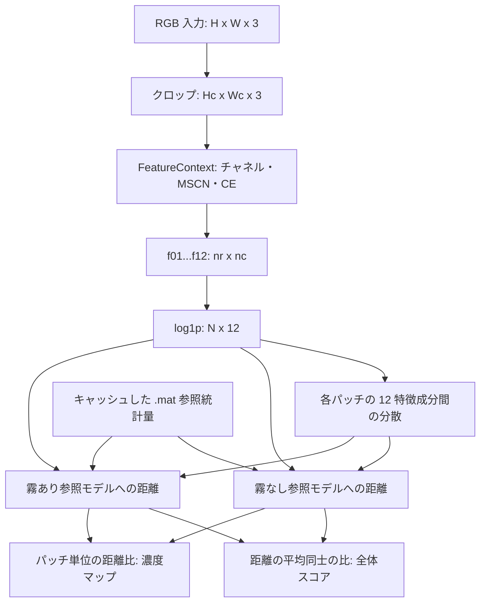
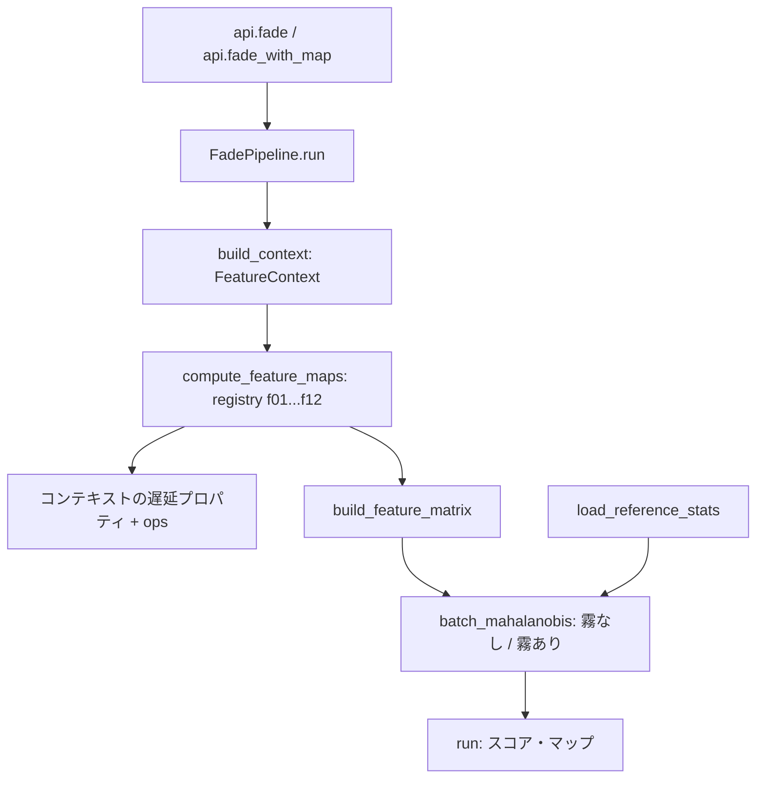

# FADE 技術ドキュメント：論文・アルゴリズム・Python 実装

[简体中文](technical_documentation.md) | [English](technical_documentation_EN.md) | [日本語](technical_documentation_JA.md)

本書は FADE の再現研究を行う読者向けです。リポジトリ内の論文 PDF と現行ソースコードを根拠にしています。**論文の根拠**は著者の定義と実験、**実装上の事実**は本プログラムの計算、**解釈**は数式・知覚的意味・コードの関係を示します。解釈を独立した実験結果として扱いません。確認したコードの基準コミットは `50643c5` です。

## 目次

1. [論文の概要](#paper)
2. [記号と全体の流れ](#flow)
3. [前処理と 12 個の特徴量](#features)
4. [参照統計量とスコア計算](#score)
5. [プログラムの実装](#implementation)
6. [論文と実装の対照](#comparison)
7. [サンプル・テスト・制約](#validation)
8. [最適化と参考資料](#references)

<a id="paper"></a>

## 1. 論文の概要

Lark Kwon Choi, Jaehee You, and Alan Conrad Bovik. **Referenceless Prediction of Perceptual Fog Density and Perceptual Image Defogging.** IEEE Transactions on Image Processing, 24(11), 3888–3901, 2015. DOI: `10.1109/TIP.2015.2456502`。[リポジトリ内の論文 PDF](../reference/FADE.pdf)。

旧文書の引用にある “Perceptual Image Quality” は、この PDF の実際の題名ではありません。正しくは “Perceptual Image Defogging” です。本改訂では技術文書の引用を修正し、指定どおり README は変更していません。以下のページ番号は誌面の番号です。3888–3901 ページは PDF の 1–14 ページに対応します。

<a id="paper-background"></a>

### 1.1 研究課題と物理的背景

**論文の根拠：** [原論文](../reference/FADE.pdf)、§I–II-A、式 (1)–(5)、pp. 3888–3890。

論文は、対応する霧のない画像、深度・透過率マップ、顕著な物体の位置、補助的な地理情報、主観評価による教師信号を必要とせず、1 枚の画像から知覚的な霧の濃度を予測することを目指しています。説明に用いる簡略化した光学モデルは次のとおりです。

$$
I(x)=J(x)t(x)+A(1-t(x)),\qquad t(x)=\exp(-\beta d(x)).
$$

$J$ は霧のない場面の放射輝度、$A$ は大気光、$t$ は透過率、$\beta$ は減衰係数、$d$ は場面までの距離です。このモデルはコントラストの低下、色の淡化、輝度の変化を説明します。FADE はこれらに関連する統計的特徴を抽出します。本プログラムでは $t$ の推定や $J$ の復元を行いません。解釈として、この知覚スコアは物理単位を持つ霧濃度や視程ではありません。

<a id="paper-contributions"></a>

### 1.2 FADE・参照モデル・DEFADE

**論文の根拠：** [原論文](../reference/FADE.pdf)、§II-B、§III、§IV、pp. 3890–3896。

自然画像統計（NSS）は自然画像の統計的な規則性を扱います。局所平均の除去とコントラスト正規化から MSCN 係数が得られます。論文は、霧によって MSCN と垂直方向の隣接積の分布、および局所コントラスト・色・輝度の特徴が変化することを示しています。FADE は 12 個の特徴量を、霧あり・霧なしの多変量ガウス（MVG）参照モデルと比較します。主観評価で学習しないことと、参照統計モデルが不要であることは異なります。

もう一つの提案である DEFADE は霧除去手法です。ホワイトバランス補正画像と 2 種類のコントラスト強調画像に重みを付け、局所 FADE 情報を利用してラプラシアンのマルチスケール融合を行います（§IV、式 (21)–(33)）。本プロジェクトが提供するのは FADE スコアとパッチ単位の濃度マップです。DEFADE の候補画像生成、重みの融合、画像再構成は実装されていません。

<a id="paper-experiments"></a>

### 1.3 論文で報告された実験と結論

**論文の根拠：** [原論文](../reference/FADE.pdf)、§III-C、§V-A、§VI-B、表 II、pp. 3893, 3896–3897。

- 参照モデル用データ：霧なし 500 枚と霧あり 500 枚。モデル構築時には代表的なパッチを選択しています。
- 主観実験：参照データと内容が重複しない別の 100 枚を、20 名の参加者が評価し、MOS を算出しています。
- 報告値：最良の LCC は 8×8 パッチで 0.8934（ロジスティック非線形回帰後）、最良の SROCC は 16×16 パッチで 0.8756 です。両者の最良値は異なるパッチサイズの結果です。
- 霧除去後の画像による FADE の検証と、DEFADE の視覚的・定量的比較も行われています。これらは論文の実験であり、本プロジェクトでは主観実験を再実施していません。

<a id="flow"></a>

## 2. 記号と全体の流れ

以下では「論文」と明示したものを除き、数式は現行プログラムの計算を表します。パッチサイズは $P=8$ に固定され、パッチ番号 $b$ は行優先順です。

$$
n_r=\lfloor H/P\rfloor,\quad n_c=\lfloor W/P\rfloor,\quad H_c=Pn_r,\quad W_c=Pn_c,\quad N=n_rn_c,\quad K=P^2=64.
$$

| 記号 | 意味と形状 |
| --- | --- |
| $I$ | RGB 入力、$(H,W,3)$。規定の入力は `uint8`、0–255 |
| $I_c$ | 左上領域を保持したクロップ後の RGB 画像、$(H_c,W_c,3)$ |
| $p_b$ | $b$ 番目の 8×8 パッチ。$K=64$ ピクセル |
| $Y,\mu,\sigma,M,V$ | グレー画像・局所平均・局所標準偏差・MSCN・垂直積マップ、$(H_c,W_c)$ |
| $F_k$ | $k$ 番目の特徴マップ、$(n_r,n_c)$、$k=1,\ldots,12$ |
| $z_b$、$Z$ | `log1p` 後の特徴ベクトルと行列、$(12,)$、$(N,12)$ |
| $\nu_r,\Sigma_r$ | クラス $r$ の参照平均と共分散、$(12,)$、$(12,12)$ |
| $v_b$、$C_b^{(r)}$ | 実装で使うベクトル内分散のスカラー値と混合行列、スカラー、$(12,12)$ |
| $d_b^{(r)},D$、$D_{\mathrm{map}}$ | パッチ距離・全体スコア・濃度マップ、$(N,)$、スカラー、$(n_r,n_c)$ |



公開 API は `fade(I) -> float` と `fade_with_map(I) -> (float, ndarray)` です。どちらも全処理を実行し、`fade()` は返却時にマップを破棄します。通常、スコアが高いほど知覚される霧が濃いことを示します。ただし画像内容、ノイズ、その他の劣化も統計量に影響するため、スコア単独で一般的な画質や霧除去の忠実度を表すものではありません。

<a id="features"></a>

## 3. 前処理と 12 個の特徴量

<a id="preprocessing"></a>

### 3.1 共通の前処理

**実装上の事実：** [`models/context.py`](../src/fade/models/context.py) は最初に画像をクロップし、必要に応じてチャネルをキャッシュします。R/G/B は `float64` へ変換され、グレー画像には次の 2 種類の定義があります。

$$
Y=\operatorname{round}(0.2989R+0.5870G+0.1140B),\qquad Y_{\mathrm{CE}}=0.299R+0.587G+0.114B.
$$

$Y$ は MSCN とエントロピー用に `int32` で保存されます。$Y_{\mathrm{CE}}$ は丸めずにグレーチャネルの CE に使われます。`np.round` の半整数の丸めは ties-to-even です。色対立チャネルは次のとおりです。

$$
rg=R-G,\qquad yb=0.5(R+G)-B.
$$

論文では第 2 チャネルを yellow-blue（`yb`）と呼び、コードでは `by` という名前を使いますが、符号の定義は上式と同じです。浮動小数点の差分であり、負の値を取り得ます。0–255 の `uint8` チャネルではありません。

**論文の根拠：** [原論文](../reference/FADE.pdf)、§II-B、式 (6)–(8)、p. 3891。

$$
w_{ij}=\frac{\exp[-(i^2+j^2)/(2s_w^2)]}{\sum_{u=-3}^{3}\sum_{v=-3}^{3}\exp[-(u^2+v^2)/(2s_w^2)]},\quad i,j\in\{-3,\ldots,3\},\quad s_w=7/6.
$$

$$
\mu=w*Y,\qquad \sigma=\sqrt{\left|w*(Y^2)-\mu^2\right|},\qquad M=\frac{Y-\mu}{\sigma+1},\qquad \xi=\frac{\sigma}{\mu}.
$$

[`ops/mscn.py`](../src/fade/ops/mscn.py) は 7×7 のガウスカーネルと `mode="nearest"` の畳み込みを使います。絶対値は丸め誤差で 2 次モーメント差が負になる場合に対応します。MSCN の分母には 1 を加えますが、$\xi$ の分母には保護項がありません。論文は 7×7 の支持領域と正規化ガウス重みを示しています。$s_w=7/6$、境界モード、グレー画像の丸めはコードで確認できる具体的な設定です。

パッチ平均を $\langle A\rangle_b=K^{-1}\sum_{x\in p_b}A(x)$ と定義します。以下の $V_1(a)$ は標本分散です。計算対象となる $n$ 個の値から平均を引き、偏差平方和を $n-1$ で割ります。`nanvar` は `NaN` を除外しますが、`var`/`std` は除外しません。いずれも `inf` を自動的に除外しません。

$$
V_1(a)=\frac{1}{n-1}\sum_{i=1}^{n}(a_i-\bar a)^2,\qquad \bar a=\frac{1}{n}\sum_{i=1}^{n}a_i.
$$

<a id="feature-index"></a>

### 3.2 特徴量の順序と論文との対応

| 特徴量 | 内容 | 論文の根拠 | コード |
| --- | --- | --- | --- |
| [f01](#f01) | MSCN の分散 | Table I; Eq. (6) | [`features/f01.py`](../src/fade/features/f01.py) |
| [f02](#f02) | 非負の垂直積の分散 | Table I; Eq. (9) | [`features/f02.py`](../src/fade/features/f02.py) |
| [f03](#f03) | 非正の垂直積の分散 | Table I; Eq. (9) | [`features/f03.py`](../src/fade/features/f03.py) |
| [f04](#f04) | 局所標準偏差の平均 | Eq. (8) | [`features/f04.py`](../src/fade/features/f04.py) |
| [f05](#f05) | 変動係数の平均 | Eq. (10) | [`features/f05.py`](../src/fade/features/f05.py) |
| [f06](#f06) | グレー CE の平均 | Eqs. (11)–(12) | [`features/f06.py`](../src/fade/features/f06.py) |
| [f07](#f07) | 黄青 CE の平均 | Eqs. (11)–(12) | [`features/f07.py`](../src/fade/features/f07.py) |
| [f08](#f08) | 赤緑 CE の平均 | Eqs. (11)–(12) | [`features/f08.py`](../src/fade/features/f08.py) |
| [f09](#f09) | グレー値のエントロピー | Eq. (13) | [`features/f09.py`](../src/fade/features/f09.py) |
| [f10](#f10) | ピクセル単位のダークチャネルの平均 | Eq. (14) | [`features/f10.py`](../src/fade/features/f10.py) |
| [f11](#f11) | 彩度の平均 | Eq. (15) | [`features/f11.py`](../src/fade/features/f11.py) |
| [f12](#f12) | カラフルネス | Eq. (16) | [`features/f12.py`](../src/fade/features/f12.py) |

表 I と特徴量の定義は pp. 3891–3892 にあります。§III-B は f04–f08、f10、f11 をパッチ内で平均し、他の特徴量をパッチから直接計算すると説明しています。以下の霧との関係は統計的な傾向の解釈であり、すべての画像に対する厳密な単調性を保証するものではありません。

<a id="f01"></a>

### 3.3 f01：MSCN の分散

$$
f_1(b)=V_1\bigl(\{M(x):x\in p_b\}\bigr).
$$

**定義と解釈：** 正規化された局所構造のばらつきを表します。霧による局所コントラストの変化は MSCN 分布の広がりに影響します（§III-A、表 I、pp. 3891–3892）。

**実装手順：** 共通の $M$ を取得 → $(n_r,n_c,64)$ に分割 → 最後の軸に `np.nanvar(..., ddof=1)` を適用します。原画像のグレー値ではなく MSCN 係数の分散です。

<a id="f02"></a>

### 3.4 f02：非負の垂直積の分散

$$
V(i,j)=M(i,j)M((i-1)\bmod H_c,j),\qquad S_b^+=\{V(x):x\in p_b,\ V(x)\geq0\},\qquad f_2(b)=V_1(S_b^+).
$$

**定義と解釈：** 垂直近傍で同符号となる MSCN 積のばらつきを表し、表 I の正側の分散に対応します（式 (9)、p. 3891）。

**実装手順：** `M * np.roll(M, 1, axis=0)` で共通の積マップを作成 → パッチへ分割 → 配列をコピーし、負値を `NaN` に置換 → `nanvar(ddof=1)` を計算します。0 は含まれます。論文の式 (9) は $(i+1,j)$ ですが、コードは前の行を使い、最初と最後の行を乗算します。パッチへの割り当てと境界が異なるため、等価とは断定しません。

<a id="f03"></a>

### 3.5 f03：非正の垂直積の分散

$$
S_b^-=\{V(x):x\in p_b,\ V(x)\leq0\},\qquad f_3(b)=V_1(S_b^-).
$$

**定義と解釈：** 異符号の積のばらつきを表し、f02 と合わせて垂直積の分布の両側を記述します（§III-A、表 I）。

**実装手順：** f02 と共通の積パッチを取得 → コピーして正値を `NaN` に置換 → `nanvar(ddof=1)` を計算します。0 は f02 と f03 の両方に含まれます。残る非 `NaN` 値が 2 個未満なら結果は `NaN` となり、自由度に関する警告が出る場合があります。

<a id="f04"></a>

### 3.6 f04：局所標準偏差の平均

$$
f_4(b)=\langle\sigma\rangle_b.
$$

**定義と解釈：** 局所的なグレー値の変動から鮮鋭度と構造情報を記述します（論文の式 (8)、p. 3891）。

**実装手順：** 共通の MSCN 計算から $\sigma$ を取得 → パッチに分割 → `np.mean(..., axis=2)` を計算します。ピクセルごとのガウス重み付き標準偏差を平均するもので、パッチ全体のグレー値から標準偏差を一度だけ求める処理ではありません。尺度は正規化前のグレー強度に対応します。

<a id="f05"></a>

### 3.7 f05：変動係数の平均

$$
f_5(b)=\langle\xi\rangle_b=\left\langle\frac{\sigma}{\mu}\right\rangle_b.
$$

**定義と解釈：** 局所輝度に対するグレー値の相対的なばらつきを測定します（論文の式 (10)、p. 3892）。

**実装手順：** ピクセルごとに $\sigma/\mu$ を計算 → パッチに分割 → 平均します。$\langle\sigma\rangle_b/\langle\mu\rangle_b$ とは異なります。コードは epsilon を加えず、`nanmean` も使わないため、平均が 0 の領域では `NaN` や `inf` が伝播する場合があります。

<a id="ce"></a>

### 3.8 f06–f08 に共通のコントラストエネルギー演算

**論文の根拠：** [原論文](../reference/FADE.pdf)、§III-A、式 (11)–(12)、p. 3892。

**実装上の事実：** [`ops/ce.py`](../src/fade/ops/ce.py) は $c\in\{Y_{\mathrm{CE}},yb,rg\}$ ごとに、水平方向と垂直方向のガウス 2 階微分応答を計算し、振幅の合成、除算による正規化、ノイズ閾値処理を行います。2 方向の応答エネルギーであり、単一の 2 次元ラプラシアン畳み込みと同一視すべきではありません。

$$
Z_c=\sqrt{(c*h_h)^2+(c*h_v)^2},\qquad \alpha_c=\max_{x}Z_c(x),\qquad R_c=\frac{\alpha_c Z_c}{Z_c+0.1\alpha_c}.
$$

$$
\mathrm{CE}_c(x)=\begin{cases}R_c(x)-\tau_c,&R_c(x)-\tau_c>10^{-7},\\0,&\text{otherwise}.\end{cases}
$$

$\alpha_c$ は各 8×8 パッチではなく、クロップ後の画像全体の各チャネルで計算されます。論文は約 3.25 ピクセルの尺度、20 ピクセルのフィルタ窓、ゲイン 0.1、閾値約 0.2353、0.2287、0.0528 を示しています。コードは以下のより具体的な値を使用します。

| チャネル | 閾値 $\tau_c$ のソース式 |
| --- | --- |
| gray | `9.225496406318721e-4 * 255` |
| yb (`by`) | `8.969246659629488e-4 * 255` |
| rg | `2.069284034165411e-4 * 255` |

再現にはカーネルの離散化も重要です。$s=3.25$、`break_off_sigma=3.0` として、`np.arange(-3s,3s,1)` で $q=0,\ldots,19$ の 20 点を生成します。ガウス関数を正規化し、微分カーネルの直流成分を除去した後、2 次モーメントを正規化します。

$$
\begin{aligned}
&u_q=-3s+q,\\
&g_q=\frac{\exp(-u_q^2/(2s^2))}{\sum_{j=0}^{19}\exp(-u_j^2/(2s^2))},\\
&a_q=\left(\frac{u_q^2}{s^4}-\frac{1}{s^2}\right)g_q,\\
&b_q=a_q-\frac{1}{20}\sum_{j=0}^{19}a_j,\\
&h_q=\frac{b_q}{\sum_{j=0}^{19}u_j^2 b_j/2}.
\end{aligned}
$$

実装は 1×20 カーネルとその転置を用い、`ndimage.convolve(..., mode="constant")` と SciPy の既定の `origin=0` を使います。既定の `border=20` では、上下各 10 行、左右各 10 列の帯を元の順序で連結し、畳み込み後に除去します。単一の端ピクセルを繰り返す処理ではなく、MSCN の `nearest` モードとも異なります。$\alpha_c=0$ なら除算で `NaN` が生じ得ますが、閾値比較は偽となり、その位置の出力は 0 のままです。既存の単色画像の CE テストはこの結果を許容しています。

<a id="f06"></a>

### 3.9 f06：グレー CE の平均

$$
f_6(b)=\langle\mathrm{CE}_{Y_{\mathrm{CE}}}\rangle_b.
$$

**計算手順と解釈：** 丸めないグレー画像を取得 → 上記の CE 演算とグレー用閾値を適用 → パッチ内で平均します。解釈として、輝度構造の局所コントラストを捉えます。CE の全設定は前節のとおりです。 論文の根拠は式 (11)–(12) と §III-B、p. 3892 です。

<a id="f07"></a>

### 3.10 f07：黄青 CE の平均

$$
f_7(b)=\langle\mathrm{CE}_{yb}\rangle_b.
$$

**計算手順と解釈：** $yb=0.5(R+G)-B$（コード名 `by`）を取得 → 黄青用の閾値で CE を計算 → パッチ内で平均します。解釈として、チャネル強度の平均ではなく、黄青の色対立チャネルのコントラスト変化を記述します。 論文の根拠は式 (11)–(12) と §III-B、p. 3892 です。

<a id="f08"></a>

### 3.11 f08：赤緑 CE の平均

$$
f_8(b)=\langle\mathrm{CE}_{rg}\rangle_b.
$$

**計算手順と解釈：** $rg=R-G$ を取得 → 赤緑用の閾値で CE を計算 → パッチ内で平均します。解釈として、f07 と合わせて色の構造を記述します。霧はこれらを弱める傾向がありますが、結果は画像内容にも依存します。 論文の根拠は式 (11)–(12) と §III-B、p. 3892 です。

<a id="f09"></a>

### 3.12 f09：グレー値のエントロピー

$$
p_b(h)=\frac{\#\{x\in p_b:Y(x)=h\}}{64},\qquad f_9(b)=-\sum_{h=0}^{255}p_b(h)\log_2 p_b(h),\qquad 0\log_2 0=0.
$$

**定義と解釈：** パッチ内のグレーヒストグラムの情報量です。論文の式 (13)（p. 3892）は `log` と記載していますが、コードは底 2 を使い、単位は bit です。8×8 パッチは 64 サンプルしかないため、256 階調が可能でも最大エントロピーは 6 bit です。

**実装手順：** 丸めた $Y$ を使用 → 64 ピクセルのパッチを作成 → [`ops/entropy.py`](../src/fade/ops/entropy.py) が 1 バッチ最大 4096 パッチを処理し、パッチ番号 ×256 のオフセットと `bincount` で独立したヒストグラムを作成 → 確率を正規化して和を計算します。RGB の各チャネルのエントロピーを別々に計算するものではありません。

<a id="f10"></a>

### 3.13 f10：ピクセル単位のダークチャネルの平均

$$
I_{\mathrm{dark}}(x)=\frac{\min(R(x),G(x),B(x))}{255},\qquad f_{10}(b)=\langle I_{\mathrm{dark}}\rangle_b.
$$

**定義と解釈：** 各ピクセルの最も暗い色チャネルの明るさです（論文の式 (14)、p. 3892）。大気光によって値が上がる場合がありますが、空や白い物体も高い値を取り得ます。

**実装手順：** 各ピクセルで RGB の最小値を取得 → 255 で割る → パッチ内平均を計算します。範囲は [0,1] です。空間近傍の最小値フィルタは追加しないため、近傍内の最小化も行うダークチャネル演算とは区別します。

<a id="f11"></a>

### 3.14 f11：彩度の平均

$$
\begin{aligned}
&U=I_c/255,\\
&u_{\max}=\max_c U_c,\\
&u_{\min}=\min_c U_c,\\
&S=\begin{cases}(u_{\max}-u_{\min})/u_{\max},&u_{\max}>0,\\0,&u_{\max}=0,\end{cases}\\
&f_{11}(b)=\langle S\rangle_b.
\end{aligned}
$$

**定義と解釈：** HSV の S 成分で、明るさに対する色の純度を表します（論文の式 (15)、p. 3892）。グレーと黒の彩度は 0 です。

**実装手順：** RGB を `float32` に変換して 255 で割る → チャネルの最大値と最小値を取得 → `np.divide(..., where=maximum>0)` で割り算し、黒の位置を 0 に保つ → パッチ内平均を計算します。S のみを計算し、H/V は計算しません。float32 正規化と演算順序は実装上の規約です。

<a id="f12"></a>

### 3.15 f12：カラフルネス

$$
\begin{aligned}
&m_{a,b}=\langle a\rangle_b,\\
&s_{a,b}=\sqrt{V_1(\{a(x):x\in p_b\})},\\
&a\in\{rg,yb\},\\
&f_{12}(b)=\sqrt{s_{rg,b}^2+s_{yb,b}^2}+0.3\sqrt{m_{rg,b}^2+m_{yb,b}^2}.
\end{aligned}
$$

**定義と解釈：** 第 1 項は色の空間的な変動、第 2 項は灰色軸からの平均のずれを表し、重みは 0.3 です（論文の式 (16)、p. 3892）。

**実装手順：** 共通の $rg,yb$ をパッチに分割 → 各チャネルで `np.std(..., ddof=1)` と `np.mean` を計算 → 上式で合成します。色差は正規化しません。論文の式 (16) の後で定義する分散は分母が $X$ ですが、コードの標準偏差に対応する分散の分母は $K-1$ です。確認できる母分散と標本分散の違いであり、等価とはみなしません。

<a id="score"></a>

## 4. 参照統計量とスコア計算

<a id="reference-models"></a>

### 4.1 論文の参照モデルとプロジェクトのデータ

**論文の根拠：** [原論文](../reference/FADE.pdf)、§III-B–D、式 (17)–(19)、pp. 3892–3893。

参照モデルの構築時、論文は特徴量を min–max 正規化し、f1、f4、f6、f9、f10、f11 で代表的なパッチを選択します。選択時には f10 の向きを反転します。霧なし画像では情報量の多いパッチを優先し、霧あり画像では逆の不等式を使います。テスト画像には全パッチを使います。正規化と選択は参照モデル構築の処理であり、現行の推論経路に無条件で追加すべきではありません。

$$
p(z;\nu,\Sigma)=\frac{\exp[-\tfrac12(z-\nu)^\mathsf{T}\Sigma^{-1}(z-\nu)]}{(2\pi)^{12/2}|\Sigma|^{1/2}}.
$$

上式は論文の式 (18) を 12 次元で表した MVG 密度です。論文は平均と共分散を最尤推定すると説明しています。本プロジェクトは以下の事前計算パラメータを読み込むのみで、参照データセット、パッチ選択段階、再推定・学習の入口は含まれていません。

| ファイル | 平均のキー / 保存形状 | 共分散のキー / 保存形状 |
| --- | --- | --- |
| [`natural_fogfree_image_features_ps8.mat`](../src/fade/data/natural_fogfree_image_features_ps8.mat) | `mu_fogfreeparam` / `(1,12)` | `cov_fogfreeparam` / `(12,12)` |
| [`natural_foggy_image_features_ps8.mat`](../src/fade/data/natural_foggy_image_features_ps8.mat) | `mu_foggyparam` / `(1,12)` | `cov_foggyparam` / `(12,12)` |

**実装上の事実：** 両パラメータセットは `float64` です。[`models/reference_stats.py`](../src/fade/models/reference_stats.py) は `importlib.resources` でパッケージ内のデータを特定し、`scipy.io.loadmat` で読み込み、`lru_cache(maxsize=1)` でキャッシュします。名前と形状は 8×8・12 特徴量の推論に対応します。ただし、このファイルだけでは生成に用いたデータ、選択過程、著者の公式パラメータとのバイト単位の一致は確認できません。

<a id="feature-matrix"></a>

### 4.2 特徴行列と実装の分散スカラー

$$
z_{b,k}=\ln(1+f_k(b)),\quad Z\in\mathbb{R}^{N\times12},\qquad v_b=\operatorname{nanvar}(z_{b,1},\ldots,z_{b,12};\mathrm{ddof}=1).
$$

特徴マップは f01–f12 の順に並べ、行優先で平坦化して列として結合します。`np.log1p` は自然対数です。論文の §III-D は対数非線形変換を説明しますが、本文で `log1p` と明示してはいません。$v_b$ は 1 パッチ内の異なる特徴成分間の分散です。パッチ間から推定する 12×12 の共分散や、パッチ内の 64 ピクセル間の分散では**ありません**。

<a id="distance"></a>

### 4.3 混合行列と距離

**論文の根拠：** [原論文](../reference/FADE.pdf)、§III-D、式 (19)、pp. 3893–3894。

論文の Mahalanobis-like 距離は、参照モデルとテスト画像への MVG 当てはめの平均・共分散を使用します。

$$
d_{\mathrm{paper}}=\sqrt{(\nu_1-\nu_2)^\mathsf{T}\left(\frac{\Sigma_1+\Sigma_2}{2}\right)^{-1}(\nu_1-\nu_2)}.
$$

**現行プログラムの数式：** $J_{12}=\mathbf{1}_{12}\mathbf{1}_{12}^{\mathsf T}$ は全要素が 1 の行列で、クラス $r$ は `free` または `foggy` です。

$$
\begin{aligned}
&\Delta_b^{(r)}=\nu_r-z_b,\\
&C_b^{(r)}=\frac{v_bJ_{12}+\Sigma_r}{2},\\
&C_b^{(r)}x_b^{(r)}=\Delta_b^{(r)},\\
&d_b^{(r)}=\sqrt{\max\left((\Delta_b^{(r)})^\mathsf{T}x_b^{(r)},0\right)}.
\end{aligned}
$$

```python
batch_cov = (patch_var[start:stop, np.newaxis, np.newaxis] + ref_cov) / 2.0
x = np.linalg.solve(batch_cov, mu[:, :, np.newaxis])
dist_sq = np.einsum("ni,ni->n", mu, x[:, :, 0])
distances[start:stop] = np.sqrt(np.maximum(dist_sq, 0.0))
```

この抜粋は [`ops/distance.py`](../src/fade/ops/distance.py) のループ内部です。`mu` はバッチの $\Delta$、`ref_cov` は $\Sigma_r$ です。分散の形状 `(B,1,1)` は参照行列の**全要素**に加算され、対角要素だけへの加算ではありません。旧文書の単位行列 $I_{12}$ による説明は誤りでした。コードは 1 バッチ最大 4096 系を直接解き、逆行列を明示的には作りません。負の二次形式を 0 に切り上げ、`NaN` は保持します。特異行列の正則化や、求解失敗時の代替処理はありません。

<a id="aggregation"></a>

### 4.4 全体スコアと局所濃度マップ

**論文の根拠：** [原論文](../reference/FADE.pdf)、式 (20)、§VI-A、pp. 3894, 3897。

$$
\begin{aligned}
&D_f=\operatorname{nanmean}_b d_b^{(\mathrm{free})},\\
&D_{ff}=\operatorname{nanmean}_b d_b^{(\mathrm{foggy})},\\
&D=\frac{D_f}{D_{ff}+1},\\
&D_{\mathrm{map}}(b)=\frac{d_b^{(\mathrm{free})}}{d_b^{(\mathrm{foggy})}+1}.
\end{aligned}
$$

論文では $D_f$ を foggy level と呼びますが、実際は**霧なし**参照モデルへの距離です。$D_{ff}$ は fog-free level と呼びますが、実際は**霧あり**参照モデルへの距離です。コードもこの対応です。定数 1 は分母を安定化します。全体スコアは距離の平均同士の比であり、通常は濃度マップの平均とは異なります。各 `nanmean` はそれぞれの `NaN` を独立に除外し、共通の有効パッチマスクを作りません。距離がすべて無効ならスコアは `NaN` になり得ます。マップはパッチ順を保持し、ピクセル解像度への補間、ガイドフィルタ、[0,1] への正規化は行いません。

<a id="implementation"></a>

## 5. プログラムの実装

<a id="module-map"></a>

### 5.1 モジュールの役割と呼び出し関係

| 層 | コードの入口 | 役割 |
| --- | --- | --- |
| API | [`api.py`](../src/fade/api.py) | 既定パイプラインの共有インスタンス。スカラーまたはスカラーとマップを返す |
| Pipeline | [`pipeline.py`](../src/fade/pipeline.py) | コンテキスト、特徴行列、距離、出力を構成 |
| Feature | [`features/base.py`](../src/fade/features/base.py) / [`features/registry.py`](../src/fade/features/registry.py) | 静的型の Protocol と f01–f12 の標準順序 |
| Context | [`models/context.py`](../src/fade/models/context.py) | 画像単位の遅延キャッシュとパッチ分割 |
| Ops | [`ops/mscn.py`](../src/fade/ops/mscn.py) / [`ops/ce.py`](../src/fade/ops/ce.py) / [`ops/entropy.py`](../src/fade/ops/entropy.py) / [`ops/distance.py`](../src/fade/ops/distance.py) / [`ops/patches.py`](../src/fade/ops/patches.py) | 再利用可能な数値演算 |
| Reference | [`models/reference_stats.py`](../src/fade/models/reference_stats.py) | パッケージ内パラメータの読み込みとプロセス内キャッシュ |



`Feature` は `name` と `compute(context)` を規定する `typing.Protocol` で、実行時に抽象メソッドを検査する `abc.ABC` ではありません。各特徴モジュールは状態を持たない `feature` オブジェクトを公開します。`FadePipeline.default()` は全特徴を登録順に取得します。`run()` は特徴行列が空でなく 12 列であることを確認しますが、名前や意味上の順序は個別に確認しません。特徴や順序の置換は参照モデルとの対応を変えます。公開 API にパッチサイズの引数はありません。内部の `FeatureContext.patch_size` を設定できても、付属の参照統計量が他のサイズに対応することは意味しません。

<a id="cache"></a>

### 5.2 共通キャッシュとデータ型

各 `run()` は新しい `FeatureContext` を作成し、その推論の 12 特徴量で共有します。`mscn` への最初のアクセスで $M,\sigma,\xi$ をまとめて計算し、`CE_gray` への最初のアクセスで 3 チャネルの CE を計算します。f02/f03 は `mscn_v_patches`、CE と f12 は `rg/by` を共有します。これらは 1 画像の処理用キャッシュであり、画像間の結果キャッシュではありません。参照 `.mat` のローダーはグローバルな LRU キャッシュを使います。

| 配列 | データ型 | 形状 |
| --- | --- | --- |
| クロップ後の RGB | 入力の型、通常は `uint8` | `(Hc,Wc,3)` |
| R/G/B, MSCN, sigma, CV, rg/by, CE | `float64` | `(Hc,Wc)` |
| 丸めたグレー値 / エントロピーの添字 | `int32` | `(Hc,Wc)` / バッチに依存 |
| 彩度 | `float32` | `(Hc,Wc)` |
| 特徴マップ | 通常は `float64`、f11 は `float32` | `(nr,nc)` |
| 特徴行列 | `float64` | `(N,12)` |
| 参照パラメータ / 出力マップ | `float64` | `(12,)`, `(12,12)` / `(nr,nc)` |

<a id="array-flow"></a>

### 5.3 パッチ分割・行列構築・ソースコード抜粋

[`ops/patches.py`](../src/fade/ops/patches.py) は `reshape(nr,8,nc,8)` → `transpose(0,2,1,3)` → `reshape(nr,nc,64)` を実行します。パッチ内の 2 次元を平坦化し、特徴マップの `ravel()` も同じ行優先のパッチ順となります。転置後の平坦化ではコピーが生じ得るため、常にゼロコピーとはいえません。

以下は `build_feature_matrix()` の入力が空でない場合の分岐です。新しい行列を作成してからインプレース変換するため、元の特徴マップは変更しません。

```python
flattened = [feature_map.ravel() for feature_map in feature_maps]
feat = np.column_stack(flattened).astype(np.float64, copy=False)
return np.log1p(feat, out=feat)
```

自然対数変換後の行列からパッチごとの分散と両参照クラスへの距離を求め、全体スコアとマップを構築します。パラメータ変換には `astype(..., copy=False)` を使い、既存の `float64` 配列の不要なコピーを避けつつ値を保持します。

<a id="comparison"></a>

## 6. 論文と実装の対照

以下の表では、確認できる差異、論文本文に明記されていない実装規約、未確認事項を区別します。差異を記録することからコードの修正方法が自動的に決まるわけではありません。本改訂はアルゴリズムを変更しません。

| 項目 | 論文の根拠 | 現行実装と確認結果 |
| --- | --- | --- |
| 12 特徴量と参照クラス | 表 I、式 (19)–(20) | 特徴の種類・標準順序・2 クラスの距離比は対応しますが、数値上の規約は個別の確認が必要です。 |
| パッチ | §III-B、§VI-A：サイズと重なりは可変 | API は重なりなしの 8×8 固定で、下端・右端の余りを切り捨てます。付属パラメータは ps8 用です。 |
| MSCN とグレー画像 | 式 (6)–(8)、式 (11) 後のグレー定義 | コードはガウス尺度 7/6、nearest 境界、2 種のグレー定義、丸めを明示します。すべてが論文本文だけから導かれるわけではありません。 |
| 隣接積 | 式 (9)：次の行を使用 | コードは前の行と循環境界を使い、正・負側ともに 0 を含めます。 |
| CE と境界 | 式 (11)–(12)：3.25、20、0.1、丸めた閾値 | 正確なサンプリング、直流除去、端の帯の連結、>1e-7 マスクはコードの規約です。公式実装との一致は未確認です。 |
| エントロピー | 式 (13)：log の底を明記せず | コードは log2、丸めたグレー値、256 ビンを使用します。 |
| カラフルネス | 式 (16) は分母 X の母分散を定義 | コードは std(ddof=1)、分母 K-1 を使用します。確認できる数値上の差異です。 |
| 対数変換 | §III-D：対数非線形変換 | コードは自然対数の log1p を使用し、論文は +1 の規約を明示していません。 |
| テスト画像の共分散 | 式 (18)–(19)：MVG の平均と完全な共分散の推定 | コードは各 z_b と 12 成分間の分散を v_b J12 として使います。画像全体の MVG 推定ではなく、論文はこの置換を導出していません。 |
| 全体スコア | 式 (20)：Df/(Dff+1) | コードは各距離配列の nanmean を独立に求めてから比を計算します。局所スコアの平均ではありません。 |
| 参照パラメータと実験 | 500+500 の参照データ、100 画像の主観実験 | .mat、3 サンプル、ソフトウェアテストのみを提供します。パラメータの生成過程と MOS 相関は独立に再現していません。 |
| 霧除去と画質 | §IV と §VI-C：DEFADE と複数指標の評価 | 本プロジェクトには DEFADE や一般的な画質予測の入口はありません。 |

<a id="validation"></a>

## 7. サンプル・テスト・制約

<a id="samples"></a>

### 7.1 付属の 3 枚の画像

以下は Pillow で RGB に変換した入力に対する現行プログラムの実測出力です。環境は Python 3.13.3、NumPy 2.4.3、SciPy 1.17.1 です。スコアは小数点以下 10 桁で示します。プロジェクトのサンプルであり、論文の 100 画像の実験全体を再現したものではありません。

| 画像 | 入力 `(H,W,3)` | クロップ後 `(Hc,Wc,3)` | FADE スコア | マップ `(nr,nc)` |
| --- | --- | --- | --- | --- |
| [test_image1.png](../test_image/test_image1.png) | `(768,576,3)` | `(768,576,3)` | `0.9113393845` | `(96,72)` |
| [test_image2.JPG](../test_image/test_image2.JPG) | `(800,600,3)` | `(800,600,3)` | `2.7121977531` | `(100,75)` |
| [test_image3.jpg](../test_image/test_image3.jpg) | `(531,800,3)` | `(528,800,3)` | `5.7674386227` | `(66,100)` |

リポジトリのルートで、`demo` 依存パッケージを含む環境から以下の完全なサンプルを実行してください。画像を読み込むだけで、ファイルは変更しません。霧の少ない画像と中程度の霧の画像では、後述の自由度に関する警告が出る場合があります。

<a id="sample-code"></a>

```python
from pathlib import Path
import numpy as np
from PIL import Image
from fade import fade_with_map

for name in ("test_image1.png", "test_image2.JPG", "test_image3.jpg"):
    with Image.open(Path("test_image") / name) as image:
        rgb = np.array(image.convert("RGB"))
    score, density_map = fade_with_map(rgb)
    print(f"{name}: shape={rgb.shape}, score={score:.10f}, map={density_map.shape}")
```

```text
test_image1.png: shape=(768, 576, 3), score=0.9113393845, map=(96, 72)
test_image2.JPG: shape=(800, 600, 3), score=2.7121977531, map=(100, 75)
test_image3.jpg: shape=(531, 800, 3), score=5.7674386227, map=(66, 100)
```

<a id="tests"></a>

### 7.2 既存テストの範囲と検証結果

リポジトリのルートで実行します。

```bash
uv sync --extra demo --extra test
uv run --extra test pytest
uv run --extra test pytest -m "not slow"
```

pip 環境では `pip install -e ".[demo,test]"` の後、`python -m pytest` を実行できます。本改訂では既存の仮想環境で完全な `python -m pytest -q` を実行し、pytest 9.0.2 で **261 件成功、RuntimeWarning 13 件**でした。テストの追加や、論文の主観実験の再実施は行っていません。

| 範囲 | 既存テストとその意味 |
| --- | --- |
| API / Pipeline | [test_api_integration.py](../tests/test_api_integration.py) / [test_pipeline.py](../tests/test_pipeline.py) — 型、形状、反復性、クロップ、16×16 の小画像、32×32 の単色グレー画像。実画像スコアは Notebook 由来の値に対し相対誤差 10% を許容し、独立した MATLAB 基準ではありません。 |
| Features / Cache | [test_features_f01_f12.py](../tests/test_features_f01_f12.py) / [test_features_registry.py](../tests/test_features_registry.py) / [test_models_context.py](../tests/test_models_context.py) — 12 特徴量の形状、数値特性、順序、チャネル数式、キャッシュ、代表的な色の彩度。 |
| Ops | [test_ops_entropy.py](../tests/test_ops_entropy.py) / [test_ops_distance.py](../tests/test_ops_distance.py) / [test_ops_ce.py](../tests/test_ops_ce.py) / [test_ops_mscn.py](../tests/test_ops_mscn.py) / [test_ops_patches.py](../tests/test_ops_patches.py) — 既知のエントロピー、バッチ境界、独立なエントロピー・直接求解との比較、float32 距離型、フィルタ・帯の付加、パッチ分割。 |
| Reference | [test_models_reference.py](../tests/test_models_reference.py) — キー、次元、有限性、対称性、半正定値性、キャッシュ。生成データの由来は検証しません。 |

ソフトウェアテストの成功は、現行動作がこれらのアサーションを満たすことを示します。参照パラメータの生成過程、公式実装との完全な一致、論文の主観データで同じ LCC/SROCC が得られることを証明するものではありません。

<a id="limits"></a>

### 7.3 現行の境界動作と適用上の制約

- **入力規約と実際の検査：** 文書の入力規約は RGB、`uint8`、`(H,W,3)` です。API は型・形状・最小サイズをまとめて検査せず、NumPy/SciPy からエラーが発生する場合があります。彩度には別の値域検査がありますが、完全な入力検証ではありません。任意の浮動小数点入力、チャネル数、極小画像への対応は保証していません。
- **小画像：** 既存のエンドツーエンドテストは 16×16 を確認しています。1 パッチ未満の次元はクロップ後に空となり、CE の端の帯の処理も画像サイズに依存します。「8×8 パッチが 1 個あれば必ず正常動作する」とは結論できません。
- **無効値：** f02/f03 のサンプル不足、平均 0 の CV 除算、その他の退化入力は `NaN/inf` を生じ得ます。`np.errstate` は `nanvar` の自由度警告を抑制しません。今回の 13 件の警告は f03 と CE の除算によるものです。パイプラインはすべての NaN を 0 に置換しません。
- **集約と求解：** `nanmean` は NaN を除外しますが、inf は除外しません。最終集約では空の平均に関する警告を抑制しますが、NaN を返す場合があります。距離計算には特異行列に対する代替処理がありません。
- **出力の解釈：** マップはパッチ格子です。スコアに固定の分類閾値はなく、[0,1] に限定されません。霧除去の品質評価には忠実度、アーティファクト、他の指標も必要です。
- **再現の範囲：** 論文の参照データ、MOS ラベル、完全な学習・選択経路、公式コードとの比較記録は含まれていません。今回の検証は付属サンプルと既存テストのみです。

<a id="references"></a>

## 8. 最適化と参考資料

<a id="optimizations"></a>

### 8.1 現行の最適化の仕組み

- **中間量の共有：** R/G/B、MSCN 関連マップ、rg/by、CE をコンテキストで必要時にキャッシュし、特徴量間の重複生成を避けます。
- **必要な彩度のみ：** float32 の経路を保ち、HSV の H/V 計算と関連配列を省きます。
- **エントロピーのバッチ処理：** 1 バッチ最大 4096 パッチで、確率の除算とエントロピーの乗算をインプレースで行います。ヒストグラム用配列は画像全体のパッチ数とともに増え続けません。
- **距離求解のバッチ処理：** 1 バッチ最大 4096 個の 12×12 行列により、同時に保持する共分散配列を減らします。スレッドプールやマルチプロセスは使わず、バッチでのベクトル化は明示的な並列スケジューリングではありません。
- **コピーの削減：** 新規特徴行列への `log1p(out=...)`、パラメータの `copy=False`、参照データのキャッシュにより、割り当てと I/O を減らします。
- **メモリの範囲：** バッチ化が制限するのは対象の作業配列です。チャネル、特徴マップ、平坦化したパッチは画像サイズに応じて増えるため、総メモリは定数ではありません。

今回は性能実験を追加していません。旧文書の 100×/50× といった主張や、完全な測定記録がない比較を検証済みの結果として残しません。上記はコードの仕組みの説明であり、特定のハードウェアでの時間やメモリ量を保証するものではありません。

<a id="source-index"></a>

### 8.2 引用と根拠の索引

| 論文の位置 | 内容 | PDF ページ |
| --- | --- | --- |
| §I–II-A; Eqs. (1)–(5), pp. 3888–3890 | 研究課題と光学モデル | 1–3 |
| §II-B; Eqs. (6)–(8), p. 3891 | MSCN | 4 |
| §III-A–B; Table I; Eqs. (9)–(16), pp. 3891–3892 | 特徴量とパッチ集約 | 4–5 |
| §III-B–D; Eqs. (17)–(19), pp. 3892–3893 | 参照パッチ選択・MVG・距離 | 5–6 |
| Eq. (20); §IV; Eqs. (21)–(33), pp. 3894–3896 | FADE の比と DEFADE | 7–9 |
| §V-A; §VI-A–B; Table II, pp. 3896–3897 | 主観実験と FADE の結果 | 9–10 |
| §VI-C; Tables IV–V, pp. 3898–3899 | DEFADE の評価 | 11–12 |

上記の論文内容はすべて[ローカル PDF](../reference/FADE.pdf) に基づき、外部の公式実装は参照していません。ソースリンクは現行リポジトリのファイルを指します。[Notebook](../test_fade.ipynb) ではサンプルスコアとマップを確認できます。将来アルゴリズムや参照パラメータを変更する際は、3 言語の数式、対照表、サンプル記録を合わせて見直してください。
